ОТЧЁТ ПО ПРАКТИЧЕСКОМУ ЗАНЯТИЮ 2

# Создание трёхмерной сцены

Unity и цифровые двойники

Разработка и проверка учебной трёхмерной сцены

Работа выполнена в Unity 6.4 версии 6000.4.6f1. В отчёте приведены параметры проекта, ход реализации, собственные изображения сцены и результаты проверки. Исходные файлы входят в комплект работы.

### Цель работы

Создать сцену из стандартных 3D-примитивов, освоить изменение Transform, настроить различимые источники освещения трёх типов и организовать три независимых вида с камер. Результат — сохранённая сцена Practical02.unity и набор изображений для проверки.

### Средства выполнения

Использован Built-in Render Pipeline, стандартный шейдер Standard и реальные динамические источники света. Изображения без интерфейса получены непосредственно методом Camera.Render в текстуру 1600 × 1000 пикселей. Снимки с панелями Hierarchy, Inspector, Scene и Game сняты с работающего редактора Unity. Иллюстрации отражают созданный проект.

## 1 Создание проекта и организация сцены

Создан отдельный проект UnityProject. В Assets выделены папки Scenes, Scripts, Materials и Editor. Сцена Practical02 содержит площадку Plane, четыре преобразованных примитива, три источника света и три камеры. Текстовые подписи размещены на площадке как объекты TextMesh и помогают сопоставить виды.

В Hierarchy выделен Cube. В Inspector видны Position, Rotation и Scale. Для перемещения используется инструмент Move, для изменения размеров — Scale, для ориентации — Rotate. В нашем случае значения задаются точно через Transform редакторским сборщиком, что делает сцену воспроизводимой.

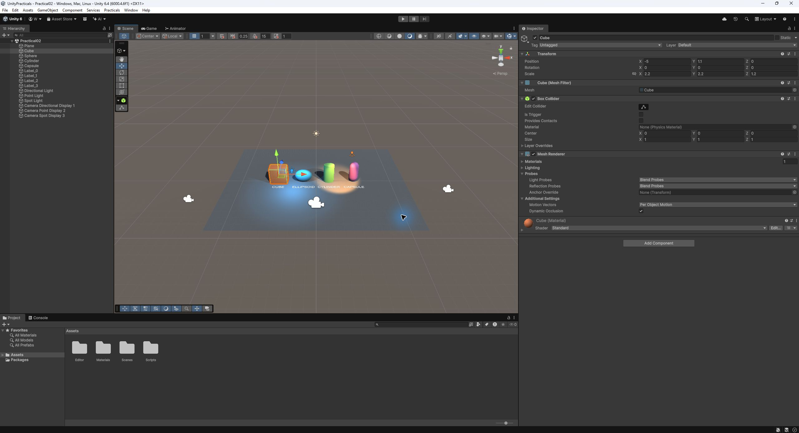

*Рисунок 1 — Сцена Practical02 во вкладке Scene и параметры выделенного параллелепипеда*

### Порядок воспроизведения

Открыть проект в Unity Hub, дождаться импорта, затем выполнить Practicals → Build scenes and evidence. Открыть Assets/Scenes/Practical02.unity. Сборщик создаёт материалы и сохраняет сцену до проведения временных экспериментов со светом.

## 2 Формирование геометрии объектов

Масштабирование по разным осям преобразует куб в прямоугольный параллелепипед, а сферу — в эллипсоид. Цилиндр и капсула также получили неодинаковые коэффициенты по X, Y и Z. Материалы различаются цветом, чтобы объекты легко читались на общем плане.

| Объект | Position X Y Z | Scale X Y Z | Размер X Y Z |
| --- | --- | --- | --- |
| Plane | 0  0  0 | 2,4  1  1,8 | 24 × 0 × 18 |
| Cube | −5  1,1  0 | 2,2  2,2  1,2 | 2,2 × 2,2 × 1,2 |
| Sphere | −1,7  0,9  0 | 2,3  1,8  1,2 | 2,3 × 1,8 × 1,2 |
| Cylinder | 1,7  1,3  0 | 1,4  1,3  0,9 | 1,4 × 2,6 × 0,9 |
| Capsule | 5  1,5  0 | 1,2  1,5  0,85 | 1,2 × 3 × 0,85 |

Стандартные Cylinder и Capsule имеют исходную высоту 2, поэтому их высота в мире равна удвоенному Scale Y. Высота центров выбрана как половина высоты объектов: нижние точки лежат на Plane при Y = 0. Стандартный Plane имеет размер 10 × 10, поэтому его итоговая площадь составляет 24 × 18 единиц.

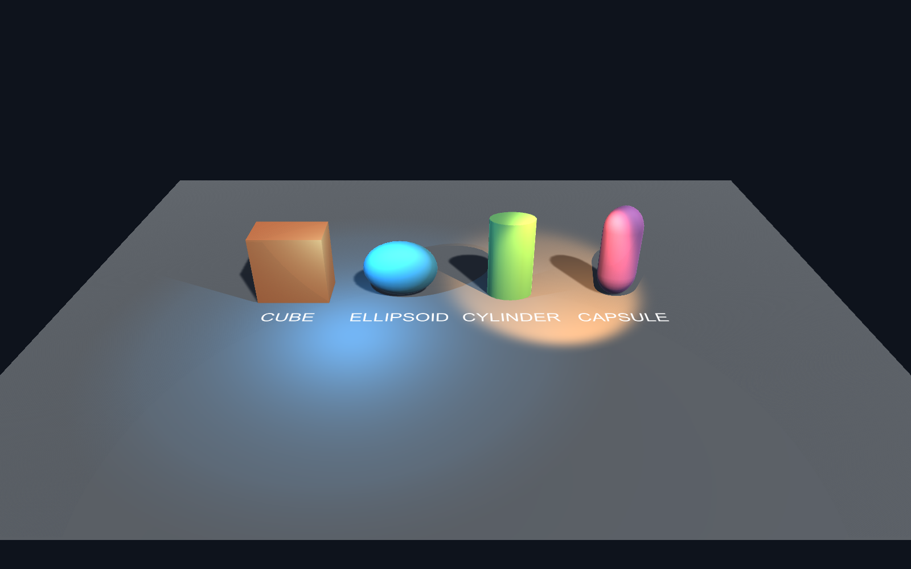

*Рисунок 2 — Общий результат с четырьмя преобразованными примитивами и тремя источниками света*

## 3 Настройка источников освещения

Directional формирует общий рисунок света и тени. Синий Point создаёт локальную подсветку слева. Тёплый Spot направлен на правую часть сцены и образует ограниченное световое пятно. Нейтральная площадка позволяет различить цветовой вклад каждого источника.

| Параметр | Directional | Point | Spot |
| --- | --- | --- | --- |
| Position | 0  7  0 | −3  3  −2 | 4  6  −3 |
| Цвет RGB | 1  0,91  0,78 | 0,2  0,65  1 | 1  0,55  0,2 |
| Intensity | 0,85 | 5 | 9 |
| Range | Не применяется | 8 | 14 |
| Spot Angle | Не применяется | Не применяется | 55° |
| Inner Spot Angle | Не применяется | Не применяется | 28° |
| Направление | Euler 48 −32 0 | Во все стороны | LookAt точки 3 0 0 |
| Тени | Soft | Soft | Soft |

Значения интенсивности относятся к Built-in Render Pipeline этого проекта. Для Directional расположение объекта не меняет освещение, определяющим является его поворот. Для Point важны положение и дальность. Для Spot дополнительно задаются направление и угол конуса.

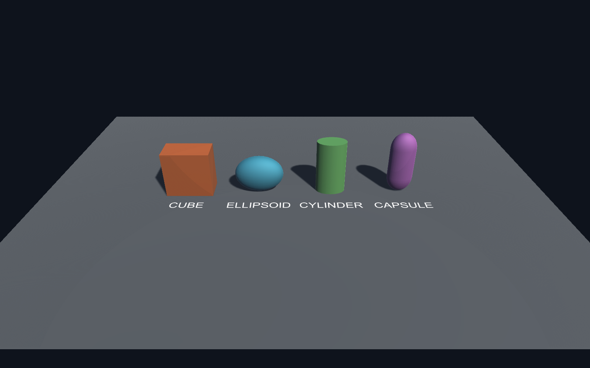

*Рисунок 3 — Изолированное действие Directional при отключённых Point и Spot*

## 4 Сравнение локальных источников

Чтобы убедиться, что вклад локальных источников не скрывается общим освещением, каждый источник включался отдельно. Слабое фоновое освещение сохранено во всех вариантах. По отдельным изображениям можно отличить круговую зону Point от направленного пятна Spot.

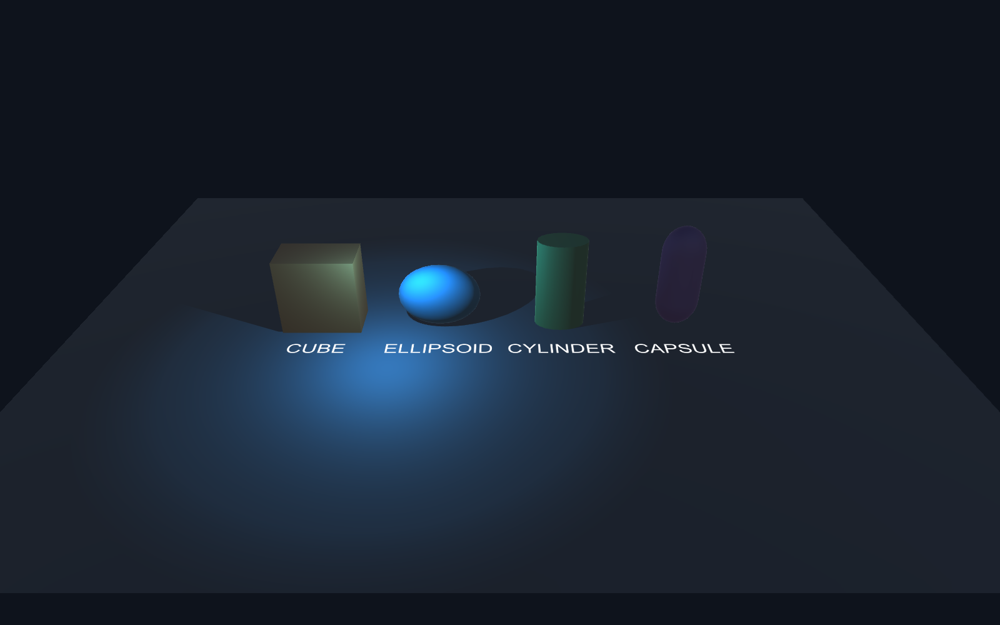

*Рисунок 4 — Один синий Point подсвечивает куб, эллипсоид и левую часть площадки*

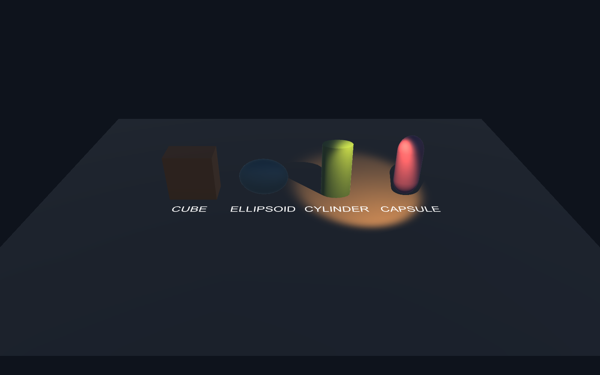

*Рисунок 5 — Один тёплый Spot выделяет цилиндр и капсулу в правой части сцены*

При совместной работе цветные области видны на площадке и на поверхностях примитивов. Это подтверждает, что присутствие источников в Hierarchy сопровождается различимым вкладом в изображение.

## 5 Тени и расположение объектов

При уменьшении угла наклона Directional с 48° до 23° тени становятся длиннее. Азимут −32° при этом сохраняется, поэтому сравнение показывает преимущественно изменение длины. После снимка исходный поворот восстановлен; эксперимент не меняет сохранённую сцену.

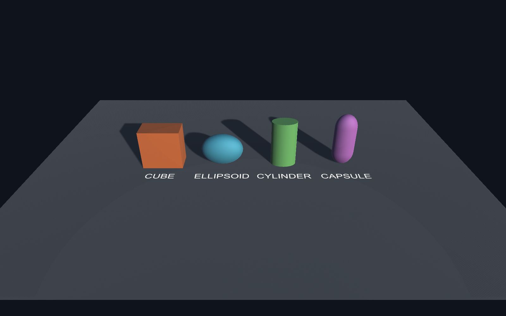

*Рисунок 6 — Удлинённые тени при более низком положении направленного света*

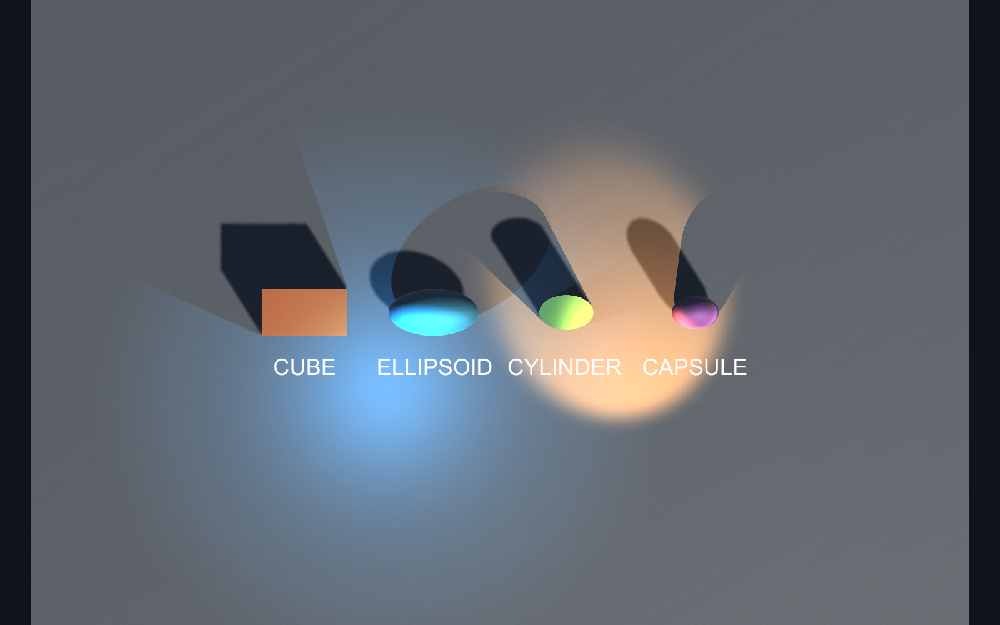

*Рисунок 7 — Вид сверху для проверки размещения примитивов и размеров площадки*

Центры примитивов разнесены по X; между их проекциями на главной камере остаются промежутки. Площадка выходит за границы группы объектов и принимает тени. При обзоре Plane снизу обратная сторона может быть невидима из-за отсечения обратных граней — это свойство односторонней геометрии.

## 6 Камеры и отдельные дисплеи

Созданы три камеры. Все они смотрят на сцену с разных точек: первая даёт общий вид, вторая приближает левую область с Point, третья — правую область с пятном Spot. Источники при этом остаются включены совместно; название камеры обозначает область наблюдения, а не фильтрацию света.

| Камера | Position | LookAt | Дисплей |
| --- | --- | --- | --- |
| Directional | 0  11  −17 | 0  0,3  0 | Display 1 |
| Point | −10  7  −12 | −2  0,6  0 | Display 2 |
| Spot | 10  8  −12 | 3  0,7  0 | Display 3 |

Угол Field of View равен 48°, Near Clip Plane — 0,1, Far Clip Plane — 100. В коде targetDisplay использует индексы 0, 1 и 2, тогда как в интерфейсе соответствующие дисплеи пронумерованы начиная с 1. Компонент DisplayActivator активирует доступные дополнительные физические дисплеи при запуске приложения.

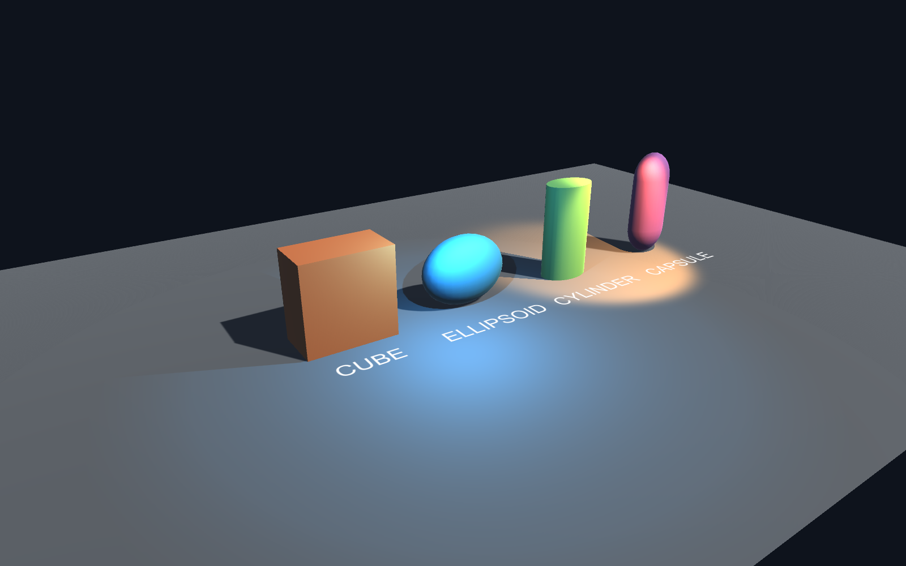

*Рисунок 8 — Изображение камеры Display 2 с акцентом на левую область и голубую подсветку*

## 7 Контроль правой камеры

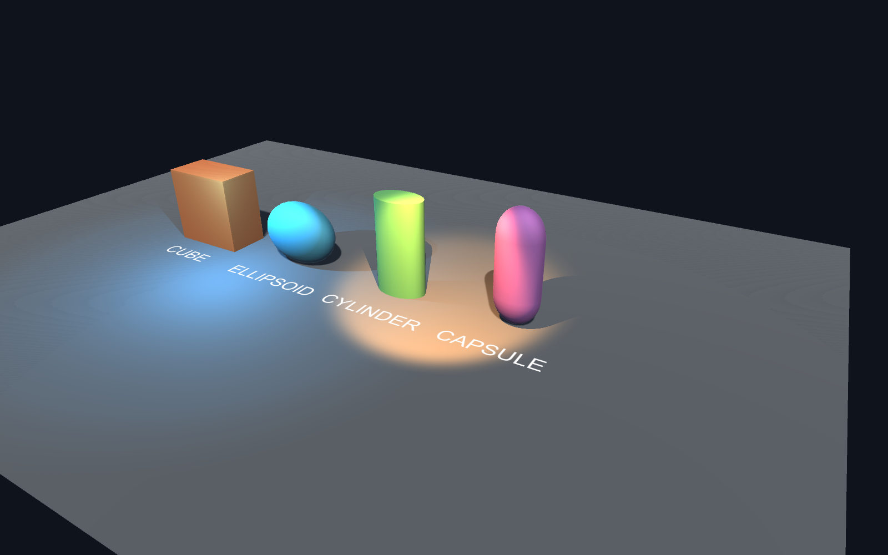

*Рисунок 9 — Изображение камеры Display 3 с акцентом на цилиндр, капсулу и пятно Spot*

Третий ракурс показывает объёмную форму капсулы, вытянутый цилиндр и освещённую правую часть площадки. В выбранном кадре четыре примитива различимы по силуэтам. Отдельные тени читаются на поверхности Plane.

### Проверка вывода

Во вкладке Game поочерёдно выбраны Display 1, Display 2 и Display 3. Ниже приведены снимки интерфейса, подтверждающие выбор соответствующего дисплея. Снимки камер без панелей приведены отдельно для подробного рассмотрения сцены. Одновременный вывод на три физических монитора зависит от подключённого оборудования; в этой работе проверено переключение трёх видов в редакторе.

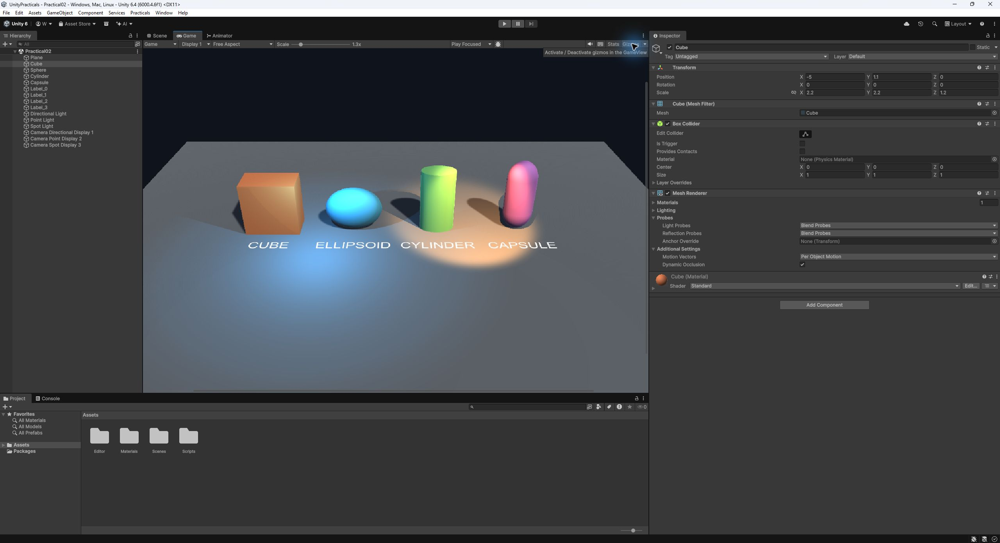

*Рисунок 10 — Game с выбранным Display 1 в редакторе Unity*

## 8 Виды Game для второго и третьего дисплеев

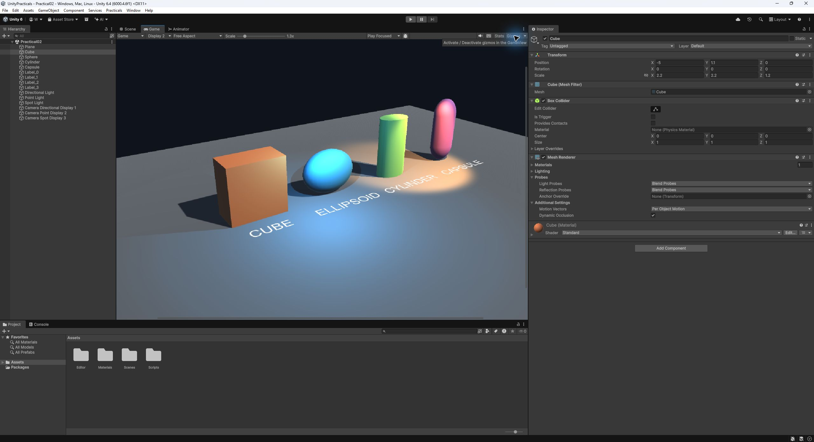

*Рисунок 11 — Game с выбранным Display 2*

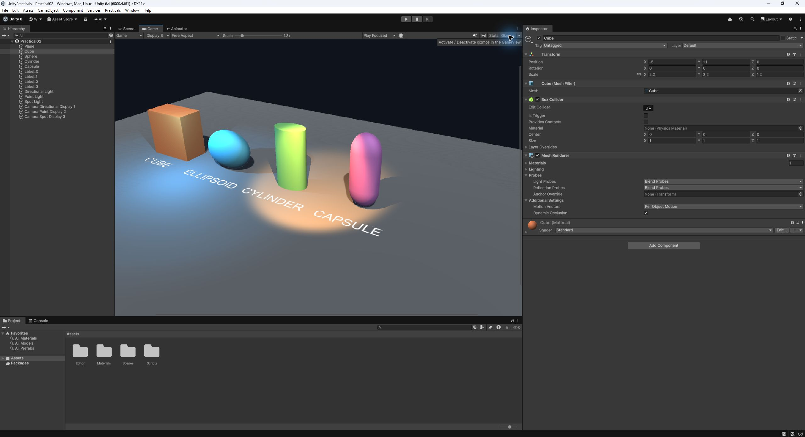

*Рисунок 12 — Game с выбранным Display 3*

Требуемые заданием четыре снимка интерфейса сохранены отдельными файлами 02_ui_scene.png и 02_ui_game1.png–02_ui_game3.png. Дополнительные изображения фиксируют раздельное действие освещения и опыт с длиной теней.

## 9 Проверка задания и вывод

| Требование самостоятельной работы | Результат |
| --- | --- |
| Преобразовать куб | Scale 2,2 2,2 1,2 — параллелепипед |
| Преобразовать сферу | Scale 2,3 1,8 1,2 — эллипсоид |
| Изменить цилиндр и капсулу | Различные масштабы всех трёх осей |
| Увеличить Plane и разместить тени | Площадка 24 × 18, тени видны |
| Избежать перекрытия на общем виде | Объекты размещены раздельно по X |
| Directional Point Spot | Три реальных источника с разными цветами |
| Различимый вклад каждого света | Три дополнительных изолированных вида |
| Три камеры и три дисплея | targetDisplay 0 1 2, проверено в Game |
| Снимки Scene и каждого Game | Четыре отдельных снимка интерфейса |

### Результат проверки проекта

Сцена успешно создана и сохранена Unity. Проверки количества камер и неравномерного масштаба Cube завершились PASS. Ошибок компиляции при сборке сцен нет. Применённая вторая сцена использует ту же геометрию как основу программных преобразований.

### Вывод

Получена трёхмерная сцена с преобразованными примитивами, тенями и тремя типами освещения. На практике показано, что форма объекта определяется геометрией и масштабом Transform, длина тени зависит от направления света, а вид сцены — от положения и ориентации камеры. Настроены три независимых назначения дисплеев и сохранены требуемые снимки. Эти приёмы составляют основу визуальной части цифрового двойника; связь с реальным оборудованием и датчиками в данное задание не входит.

### Источники

1. Практическое занятие 2. Методические материалы преподавателя Вострокнутова И. Е. Файл задания, предоставленный для выполнения работы. В исходнике указана дисциплина «Математика для программирования», 7 семестр, 2025–2026 гг.

2. Unity Technologies. Time.deltaTime. Документация Unity 6. Дата обращения 04.11.2026. https://docs.unity.com/en-us/engine/6000.0/script-reference/unityengine/time/deltatime

3. Исходные файлы проекта UnityProject, сцены Assets/Scenes и редакторский сборщик Assets/Editor/LabBuilder.cs. Журнал автоматизированной проверки verification.txt.
