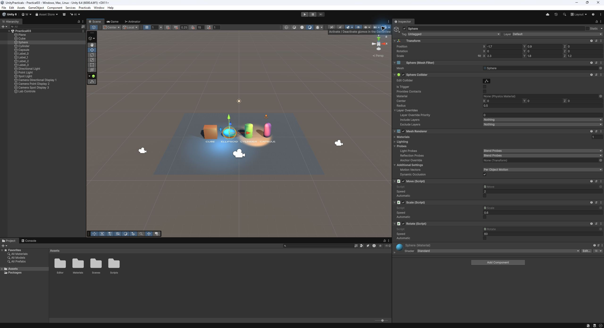
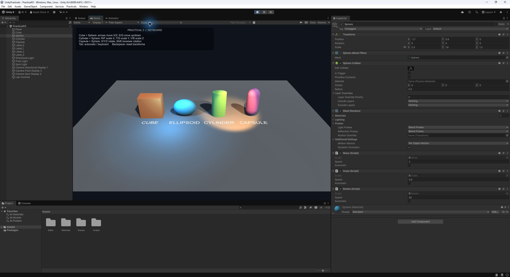
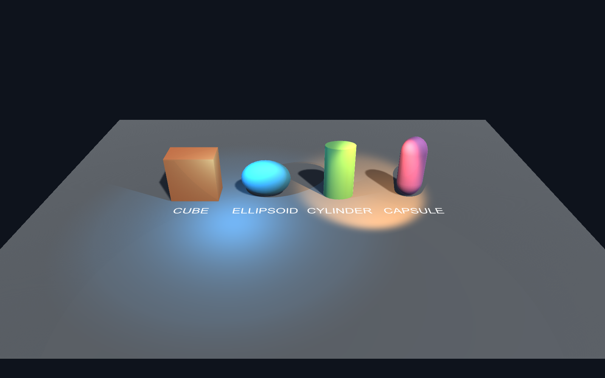
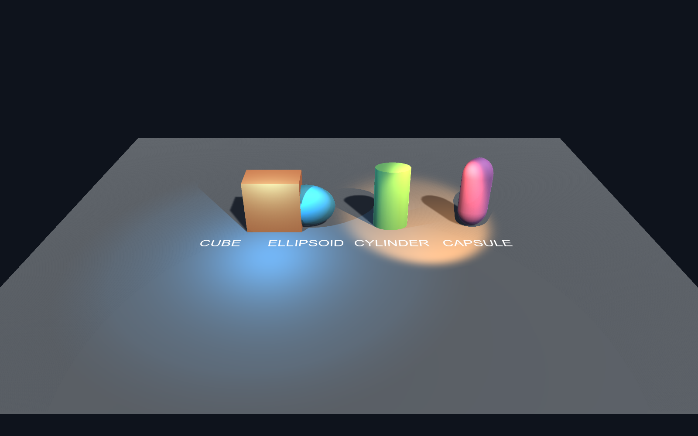
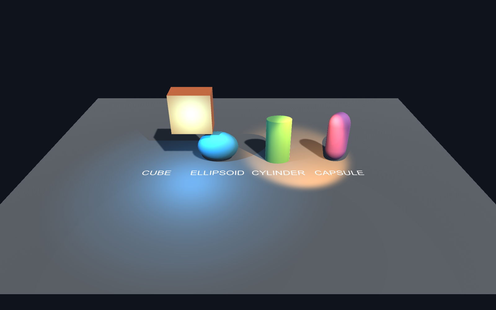
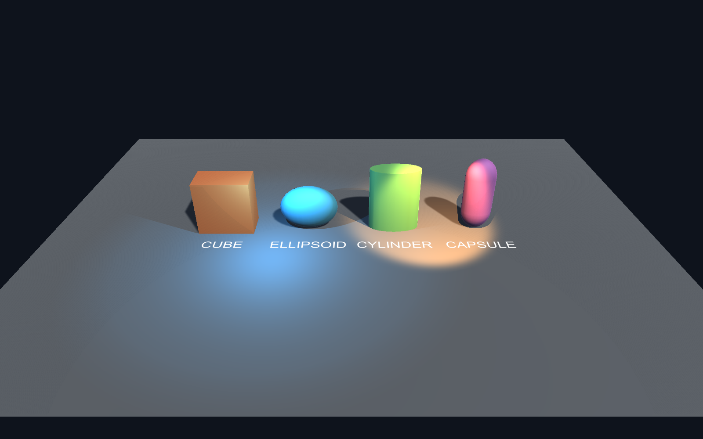
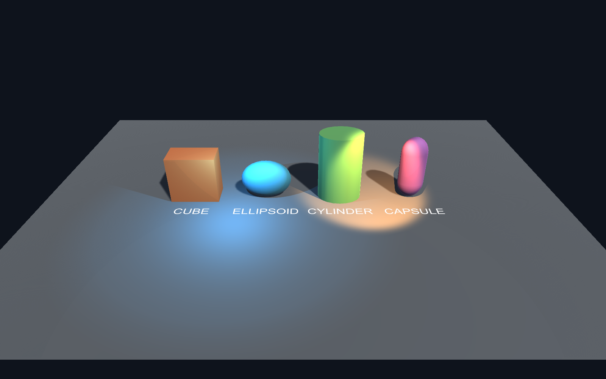
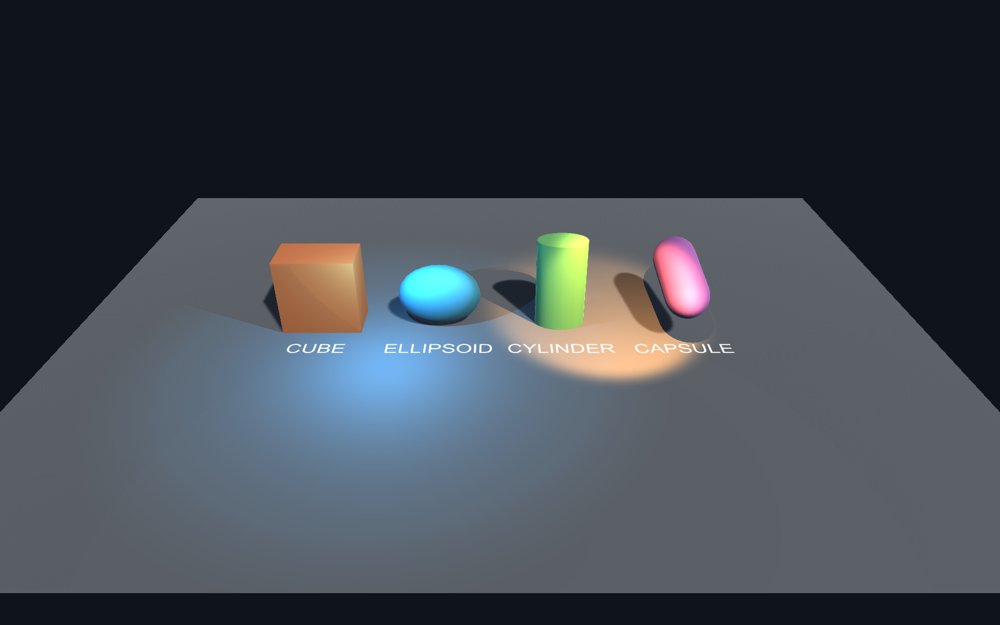
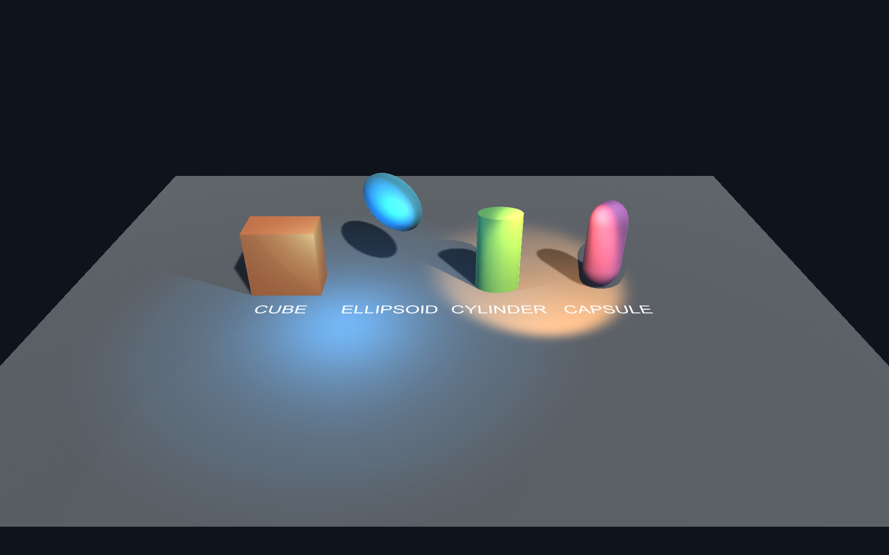
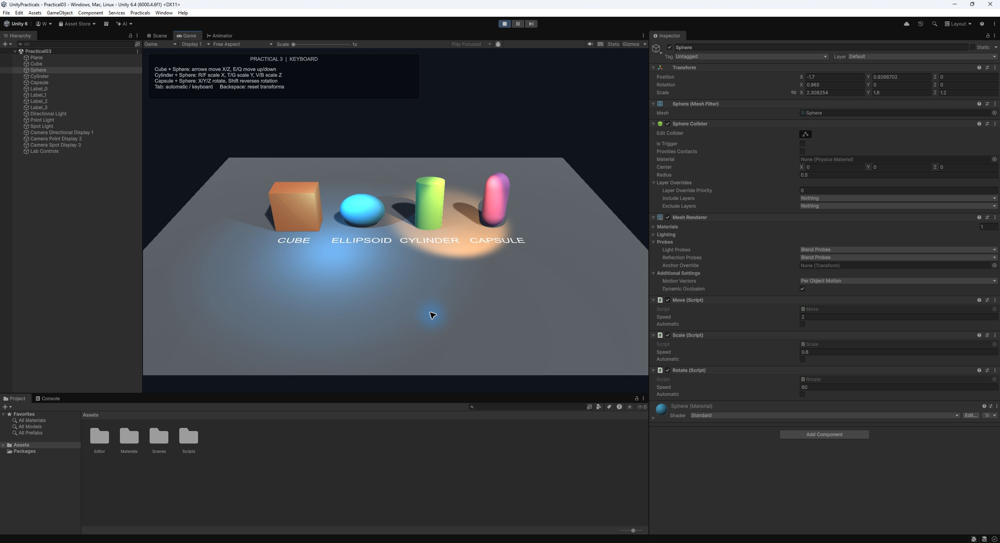

ОТЧЁТ ПО ПРАКТИЧЕСКОМУ ЗАНЯТИЮ 3

# Программное изменение объектов

Unity и цифровые двойники

Разработка и проверка учебной трёхмерной сцены

Работа выполнена в Unity 6.4 версии 6000.4.6f1. В отчёте приведены параметры проекта, ход реализации, собственные изображения сцены и результаты проверки. Исходные файлы входят в комплект работы.


4 ноября 2026 года

### Цель работы

Реализовать программное перемещение, масштабирование и вращение 3D-объектов на C#. Организовать управление с клавиатуры, добавить вертикальное перемещение куба, независимый масштаб цилиндра по трём осям и совместить три скрипта на сфере.

### Полученный результат

Создана сцена Practical03.unity. Cube и Sphere используют Move, Cylinder и Sphere используют Scale, Capsule и Sphere используют Rotate. Реализованы автоматический режим, переключение на клавиатуру и возврат к исходному Transform. Детерминированные проверки выполнены в Unity, а ввод E, R, X и сброс проверены в Play Mode.

## 1 Структура программного управления

Поведение разделено между тремя компонентами MonoBehaviour. Метод Update считывает клавиши и передаёт направление вместе с Time.deltaTime в Step. Step изменяет соответствующее свойство Transform. Такое разделение позволяет проверять один и тот же рабочий код с заранее заданным временем шага.

| Объект | Компоненты | Изменяемое свойство |
| --- | --- | --- |
| Cube | Move | position |
| Cylinder | Scale | localScale |
| Capsule | Rotate | localRotation |
| Sphere | Move, Scale, Rotate | Все три свойства |



*Рисунок 1 — Inspector сферы с одновременно назначенными Move, Scale и Rotate*

Набор Transform доступен через встроенное свойство transform. Повторный GetComponent<Transform>() в каждом кадре не нужен. Поля speed и automatic доступны в Inspector, поэтому скорости можно изменять без редактирования кода.

## 2 Назначение клавиш и режимов

| Действие | Клавиши | Объекты |
| --- | --- | --- |
| Вправо и влево по X | → и ← | Cube, Sphere |
| Вперёд и назад по Z | ↑ и ↓ | Cube, Sphere |
| Вверх и вниз по Y | E и Q | Cube, Sphere |
| Увеличить и уменьшить Scale X | R и F | Cylinder, Sphere |
| Увеличить и уменьшить Scale Y | T и G | Cylinder, Sphere |
| Увеличить и уменьшить Scale Z | V и B | Cylinder, Sphere |
| Вращение вокруг X Y Z | X Y Z | Capsule, Sphere |
| Обратное вращение | Shift + X Y Z | Capsule, Sphere |
| Автоматический режим | Tab | Все управляемые объекты |
| Сброс к исходному Transform | Backspace | Все управляемые объекты |

В ручном режиме объект остаётся неподвижным, пока соответствующие клавиши не нажаты. Input.GetKey позволяет удерживать клавишу для непрерывного изменения. Противоположные направления взаимно вычитаются: одновременные E и Q дают нулевую вертикальную составляющую.

Перед вводом требуется щёлкнуть по рабочей области Game. Установлен Input Manager, совместимый с Input.GetKey из методички. В автоматическом режиме Move направлен по +X, Scale увеличивает все оси, Rotate вращает вокруг всех осей. При долгом автоматическом перемещении объект может покинуть кадр; Backspace возвращает Transform, Tab прекращает автоматические изменения.



*Рисунок 2 — Сцена в Play Mode и экранная памятка управления*

## 3 Перемещение по горизонтали

В Move формируется вектор направления из трёх компонентов. Координата X определяется стрелками вправо и влево, Z — стрелками вверх и вниз, Y — клавишами E и Q. Направление ограничивается по длине единицей, поэтому одновременное движение по диагонали не увеличивает общую скорость.

Формула изменения: position = position + ClampMagnitude(direction, 1) × speed × dt. При speed = 2 и dt = 1 движение по +X даёт смещение 2 единицы. Начальная позиция Cube равна (−5; 1,1; 0), после шага вправо — (−3; 1,1; 0).



*Рисунок 3 — Исходное положение объектов перед программными преобразованиями*



*Рисунок 4 — Cube смещён на две единицы вправо вызовом рабочего метода Move.Step*

## 4 Вертикальное перемещение куба

Первое самостоятельное задание реализовано клавишами E и Q. Положительная составляющая Y поднимает объект, отрицательная опускает. Высота объекта не ограничивается искусственным барьером; поскольку перемещение изменяет Transform напрямую и Rigidbody отсутствует, гравитация его не возвращает.



*Рисунок 5 — Cube после шага вправо и подъёма на две единицы до Y = 3,1*

Это контрольный снимок при dt = 1: он показывает заметное смещение для сравнения. В интерактивном Play Mode время удержания клавиши определяется реальными кадрами. На снимке ниже после короткого E позиция сферы изменилась с Y = 0,9 до Y = 0,9266702. Одновременно вверх перемещается и Cube, так как к обоим привязан Move.


*Рисунок 6 — Реальная проверка E в Play Mode с изменением Position Y в Inspector*

## 5 Независимый масштаб цилиндра

В Scale каждой оси соответствует своя пара клавиш. При R/F изменяется только X, при T/G — только Y, при V/B — только Z. Скорость равна 0,6 единицы масштаба в секунду. Вектор масштаба ограничен по каждой оси интервалом от 0,2 до 4, чтобы не допустить исчезновения объекта, отрицательного масштаба или бесконтрольного роста.



*Рисунок 7 — Увеличение Scale X цилиндра с 1,4 до 2,0*


*Рисунок 8 — Следующий шаг увеличивает Scale Y с 1,3 до 1,9*

Изображения сняты последовательно. На втором увеличенный X сохранён, а Y дополнительно изменён. Поскольку опорная точка цилиндра находится в центре, масштабирование по Y меняет высоту относительно центра; при необходимости сохранения опоры на полу нужно отдельно корректировать position.y.

## 6 Масштаб по третьей оси и проверка ввода



*Рисунок 9 — Дополнительное увеличение Scale Z с 0,9 до 1,5*

После трёх последовательных шагов цилиндр имеет Scale (2,0; 1,9; 1,5). Затем проверены нижняя и верхняя границы. Большой отрицательный шаг привёл к (0,2; 0,2; 0,2), большой положительный — к (4; 4; 4). Исходный масштаб восстановлен перед дальнейшими экспериментами.


*Рисунок 10 — Короткое нажатие R в Play Mode изменило Scale X сферы до 2,308254*

Одинаковая реакция сферы и цилиндра обеспечивается назначением одного класса Scale двум объектам. Значения Y и Z сферы при нажатии только R сохраняются равными 1,8 и 1,2, что подтверждает независимость осей.

## 7 Программное вращение

В Rotate считываются X, Y и Z. Каждая активная ось добавляет speed × dt градусов к текущим локальным углам. Углы преобразуются в кватернион через Quaternion.Euler и записываются в localRotation. При speed = 60 и dt = 1 поворот вокруг одной оси составляет 60°. Shift меняет знак направления.


*Рисунок 11 — Капсула после поворота на 60° вокруг оси X*



*Рисунок 12 — После следующего шага добавлены повороты вокруг Y и Z*

Кватернион является математическим представлением вращения. Цветные кольца инструмента Rotate в редакторе — манипулятор, а не определение кватерниона. В этой учебной реализации используется добавление углов Эйлера; для сложной кинематики нужны явно определённый порядок вращений и система координат.

## 8 Совместное применение трёх скриптов

На Sphere одновременно назначены Move, Scale и Rotate. Компоненты изменяют разные свойства Transform, поэтому перемещение, деформация и вращение могут выполняться одновременно. В контрольном опыте сфере задано направление движения (0; 1; 1), масштабирования (1; −0,5; 1) и вращения (1; 1; 0) при dt = 1.



*Рисунок 13 — Сфера перемещена, деформирована и повёрнута совместной работой трёх компонентов*

После нормализации направления смещение по Y и Z равно примерно 1,4142 единицы. Итоговый масштаб сферы составляет (2,9; 1,5; 1,8). Её углы после данного шага заданы как (60°; 60°; 0°). Неравномерный масштаб делает изменение ориентации эллипсоида видимым.



*Рисунок 14 — Реальное нажатие X в Play Mode изменило Rotation X сферы до 0,965°*

## 9 Сброс и сохранение сцены

LabControls запоминает начальные position, localScale и localRotation в Start. Нажатие Backspace возвращает эти значения всем четырём управляемым объектам. Это удобно для повторения опытов без перезапуска проекта. В автоматическом режиме сброс возвращает положение на текущий кадр, но дальнейшие изменения продолжатся до переключения Tab.


*Рисунок 15 — После Backspace у сферы восстановлены Position, Rotation и Scale*

В интерактивной проверке после E, R и X значения сферы отличались от исходных. После Backspace снова получены Position (−1,7; 0,9; 0), Rotation (0; 0; 0), Scale (2,3; 1,8; 1,2). Проверка закончена выходом из Play Mode. Сцены сохранены с исходной расстановкой, а не с временными опытными значениями.

### Сохранение проекта

Сцены находятся в Assets/Scenes, а скрипты в Assets/Scripts. Параметры скорости сохраняются вместе с компонентами сцены. Для переноса проекта достаточно Assets, Packages и ProjectSettings; папку Library можно не включать, поскольку Unity создаст её заново при импорте.

## 10 Проверка реализации

В журнале verification.txt сохранены 11 строк PASS. Две относятся к базовой сцене работы 2, девять — к программным преобразованиям работы 3. Проверки вызывают реальные Step на настоящих Transform внутри Unity, а не повторяют расчёт в отдельной имитации движка.

| Проверка работы 3 | Фактический результат |
| --- | --- |
| Move вправо 1 с | Смещение +2 по X, PASS |
| Move вверх 1 с | Смещение +2 по Y, PASS |
| Обратные перемещения | Возврат к исходной позиции, PASS |
| Scale только X | X увеличен на 0,6, Y сохранён, PASS |
| Минимальный масштаб | Все оси ограничены 0,2, PASS |
| Максимальный масштаб | Все оси ограничены 4, PASS |
| Rotate по X 1 с | 60° с допуском 0,01°, PASS |
| Три компонента сферы | Move, Scale, Rotate назначены, PASS |
| 30 и 120 кадров за 1 с | Позиции совпали с допуском 0,001, PASS |

### Отдельная проверка клавиатуры

В работающем Game проверены E, R, X и Backspace. Изменения зафиксированы в Inspector и на снимках интерфейса. Остальные пары клавиш описаны в коде и используют тот же путь Update → Step; полный перебор всех комбинаций клавиатуры не проводился.

### Почему используется время кадра

Прибавление 0,1 в каждом Update связывает скорость с числом кадров. При 30 FPS получается 3 единицы за секунду, при 120 FPS — 12. В выполненном коде используется speed × Time.deltaTime. В проверке 30 шагов по 1/30 секунды и 120 шагов по 1/120 секунды дали одинаковое смещение 2 единицы.

## 11 Исходный код перемещения

Файл Move.cs. Клавиши стрелок и E/Q задают направление, automatic включает движение вправо. Код ниже соответствует файлу проекта.

```csharp
using UnityEngine;
public class Move : MonoBehaviour
{
    public float speed = 2f;
    public bool automatic;
    void Update()
    {
        Vector3 direction = automatic ? Vector3.right : new Vector3(
            (Input.GetKey(KeyCode.RightArrow) ? 1 : 0) - (Input.GetKey(KeyCode.LeftArrow) ? 1 : 0),
            (Input.GetKey(KeyCode.E) ? 1 : 0) - (Input.GetKey(KeyCode.Q) ? 1 : 0),
            (Input.GetKey(KeyCode.UpArrow) ? 1 : 0) - (Input.GetKey(KeyCode.DownArrow) ? 1 : 0));
        Step(direction, Time.deltaTime);
    }
    public void Step(Vector3 direction, float dt)
    {
        transform.position += Vector3.ClampMagnitude(direction, 1f) * speed * dt;
    }
}
```

### Разбор алгоритма

Тернарный оператор переводит состояние каждой клавиши в 0 или 1. Разность противоположных клавиш формирует число −1, 0 или 1. Vector3.ClampMagnitude ограничивает длину направления, а Step записывает новое положение объекта. Внешний параметр dt позволяет использовать метод как из Update, так и при детерминированной проверке.

## 12 Исходный код масштабирования

Файл Scale.cs. Изменение каждой оси независимо. Ограничения применяются после расчёта нового масштаба.

```csharp
using UnityEngine;
public class Scale : MonoBehaviour
{
    public float speed = 0.6f;
    public bool automatic;
    void Update()
    {
        Vector3 direction = automatic ? Vector3.one : new Vector3(
            (Input.GetKey(KeyCode.R) ? 1 : 0) - (Input.GetKey(KeyCode.F) ? 1 : 0),
            (Input.GetKey(KeyCode.T) ? 1 : 0) - (Input.GetKey(KeyCode.G) ? 1 : 0),
            (Input.GetKey(KeyCode.V) ? 1 : 0) - (Input.GetKey(KeyCode.B) ? 1 : 0));
        Step(direction, Time.deltaTime);
    }
    public void Step(Vector3 direction, float dt)
    {
        Vector3 s = transform.localScale + direction * speed * dt;
        transform.localScale = new Vector3(Mathf.Clamp(s.x, 0.2f, 4f), Mathf.Clamp(s.y, 0.2f, 4f), Mathf.Clamp(s.z, 0.2f, 4f));
    }
}
```

### Выбор ограничений

Нижняя граница 0,2 сохраняет видимую геометрию и положительную ориентацию масштаба. Верхняя граница 4 ограничивает размер в учебной сцене. Эти значения являются настройкой реализации и могут быть изменены под размеры конкретного цифрового двойника.

## 13 Исходный код вращения

Файл Rotate.cs. Ручной и автоматический режимы используют одну функцию изменения ориентации.

```csharp
using UnityEngine;
public class Rotate : MonoBehaviour
{
    public float speed = 60f;
    public bool automatic;
    void Update()
    {
        Vector3 axes = automatic ? Vector3.one : new Vector3(
            Input.GetKey(KeyCode.X) ? 1 : 0,
            Input.GetKey(KeyCode.Y) ? 1 : 0,
            Input.GetKey(KeyCode.Z) ? 1 : 0);
        if (Input.GetKey(KeyCode.LeftShift) || Input.GetKey(KeyCode.RightShift)) axes = -axes;
        Step(axes, Time.deltaTime);
    }
    public void Step(Vector3 axes, float dt)
    {
        transform.localRotation = Quaternion.Euler(transform.localEulerAngles + axes * speed * dt);
    }
}
```

### Примечания к математической модели

Локальные углы используются относительно родительского Transform. В данной сцене примитивы являются корневыми объектами, поэтому их локальные и мировые координаты совпадают. При добавлении родителя результаты будут зависеть от его преобразования. Вращение физического тела с Rigidbody и движение через физические столкновения не входят в текущую реализацию.

## 14 Вывод по работе

Реализованы три независимых C#-компонента для изменения положения, масштаба и ориентации. Самостоятельные задания выполнены: Cube перемещается по вертикали клавишами E и Q; Cylinder масштабируется отдельно по X, Y и Z; Sphere объединяет три вида преобразований. Настроены скорости, ограничения масштаба и сброс состояния.

Скрипты успешно скомпилированы Unity и применены к объектам сохранённой сцены. Детерминированные проверки подтвердили ожидаемые преобразования, а проверка Play Mode показала работу реального клавиатурного ввода. Использование Time.deltaTime устраняет прямую зависимость скорости от количества Update за секунду.

### Связь с цифровыми двойниками

Сцена демонстрирует способы программного изменения визуальной модели. В цифровом двойнике источником параметров могут стать координаты, углы и размеры, поступающие от датчиков или расчётной модели. В данной работе источником управляющих воздействий являются клавиатура и автоматический режим. Телеметрия, сетевые протоколы и синхронизация с физическим объектом не реализуются, поскольку отсутствуют в задании.

### Запуск и повторение опытов

Открыть Practical03.unity, нажать Play, выбрать Display 1, щёлкнуть внутри Game. Использовать таблицу клавиш из раздела 2. Для повторения нажать Backspace. Для автоматического преобразования нажать Tab и затем остановить режим повторным Tab. По окончании выйти из Play Mode. Для повторной генерации контрольных изображений выполнить Practicals → Build scenes and evidence вне Play Mode.

### Источники

1. Практическое занятие 3. Методические материалы преподавателя Вострокнутова И. Е. Файл задания, предоставленный для выполнения работы. В исходнике указана дисциплина «Математика для программирования», 7 семестр, 2025–2026 гг.

2. Unity Technologies. Time.deltaTime. Документация Unity 6. Дата обращения 04.11.2026. https://docs.unity.com/en-us/engine/6000.0/script-reference/unityengine/time/deltatime

3. Исходные файлы проекта UnityProject, сцены Assets/Scenes и редакторский сборщик Assets/Editor/LabBuilder.cs. Журнал автоматизированной проверки verification.txt.
