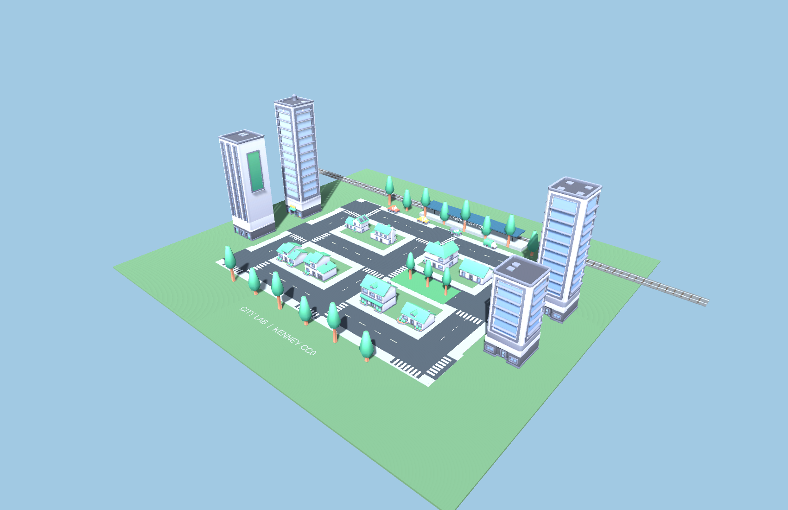
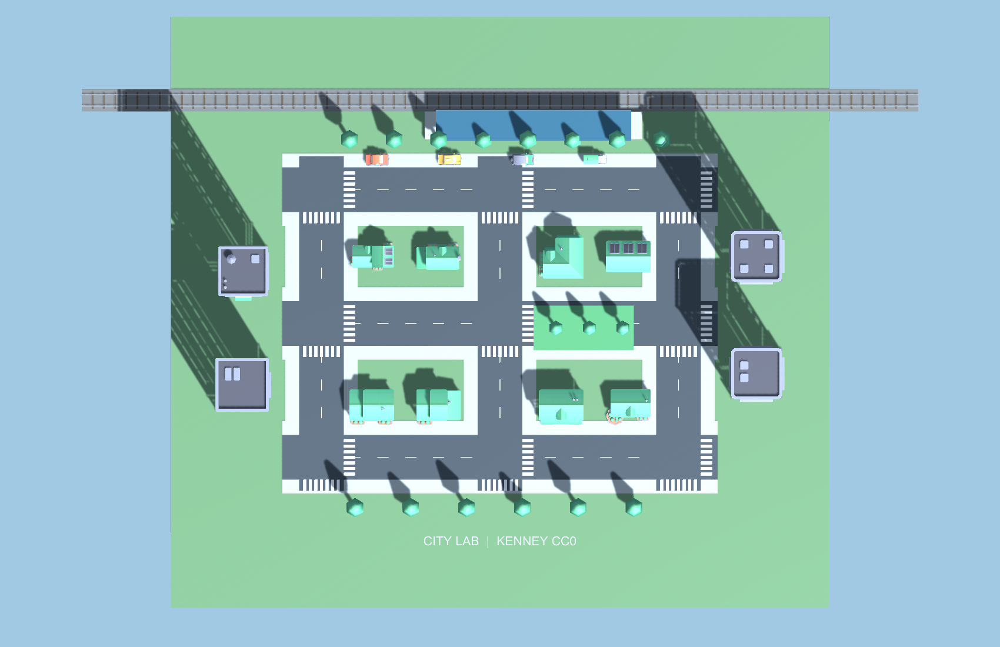
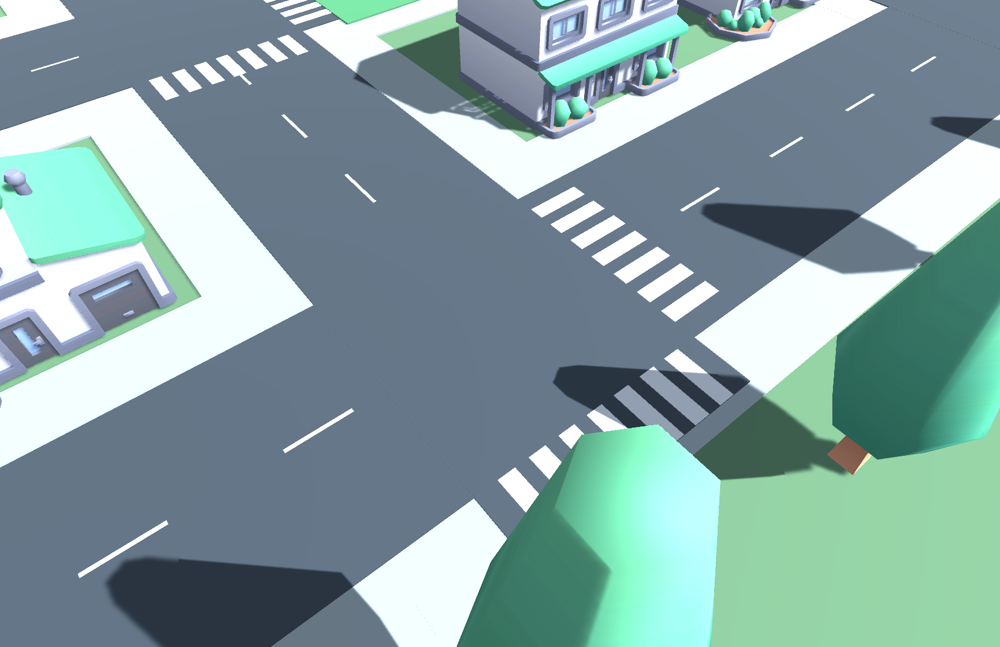
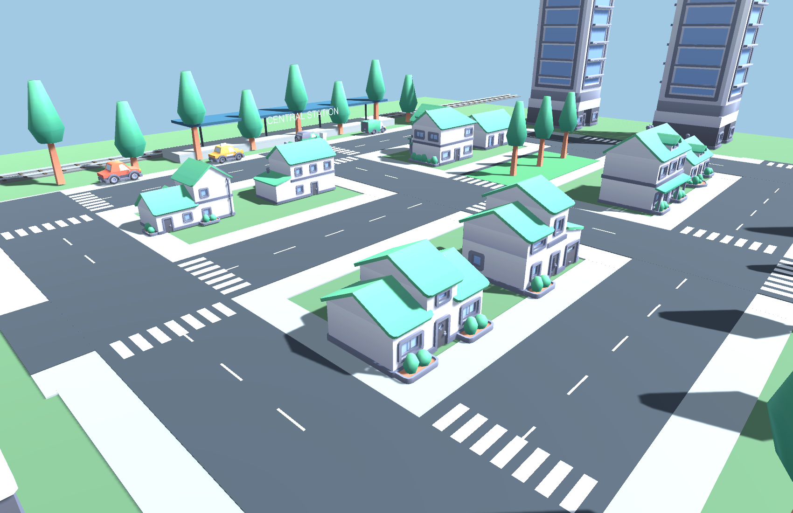
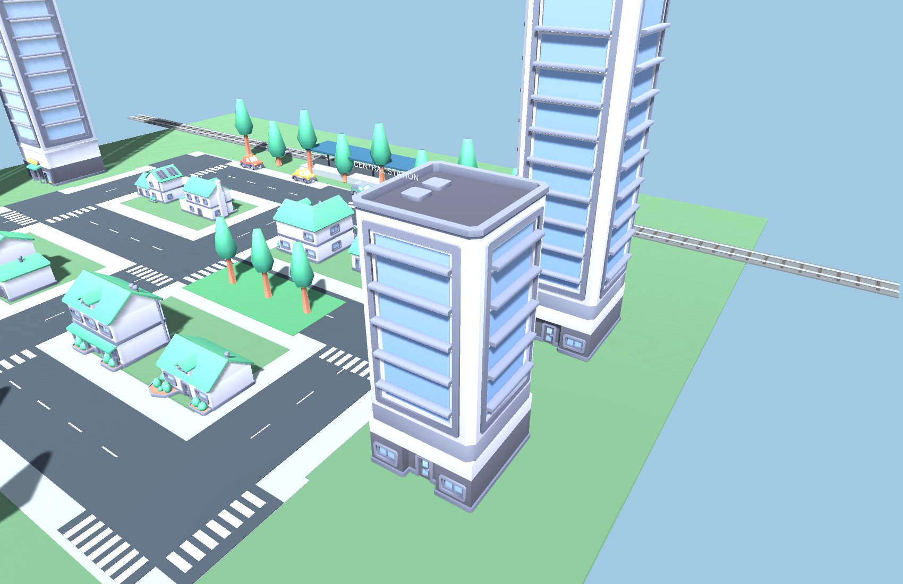
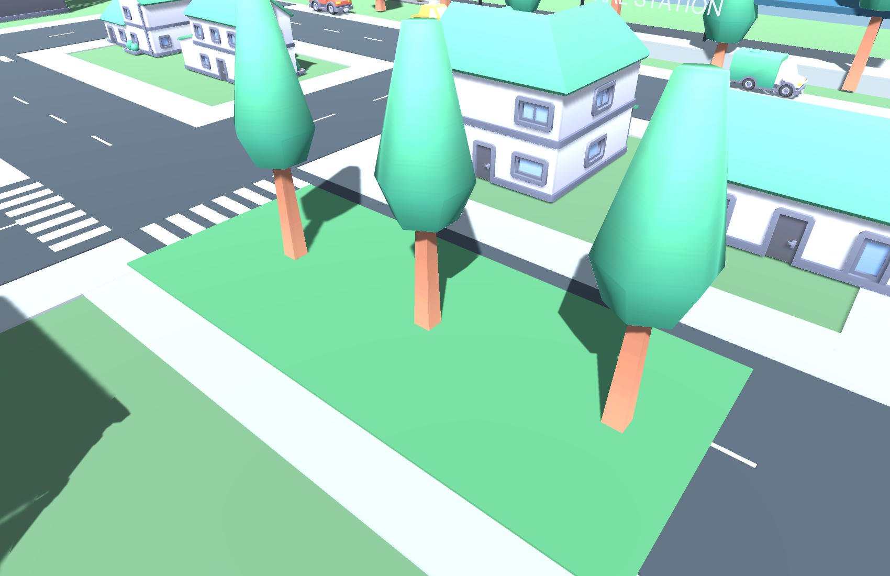
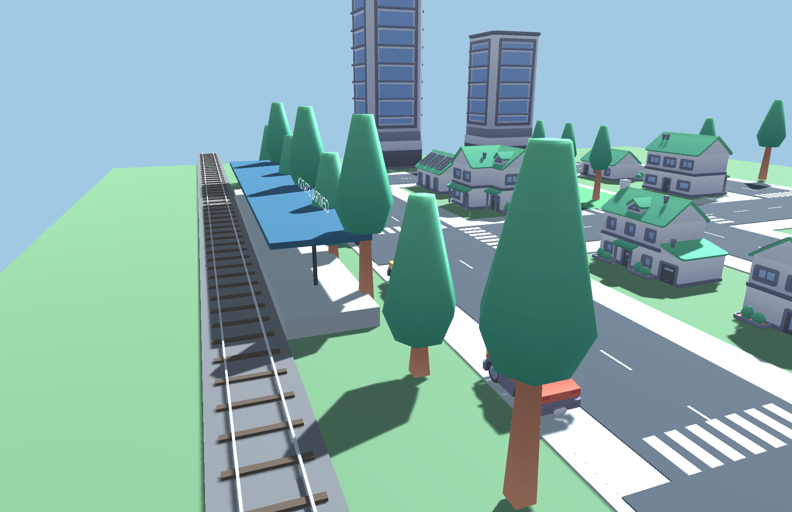
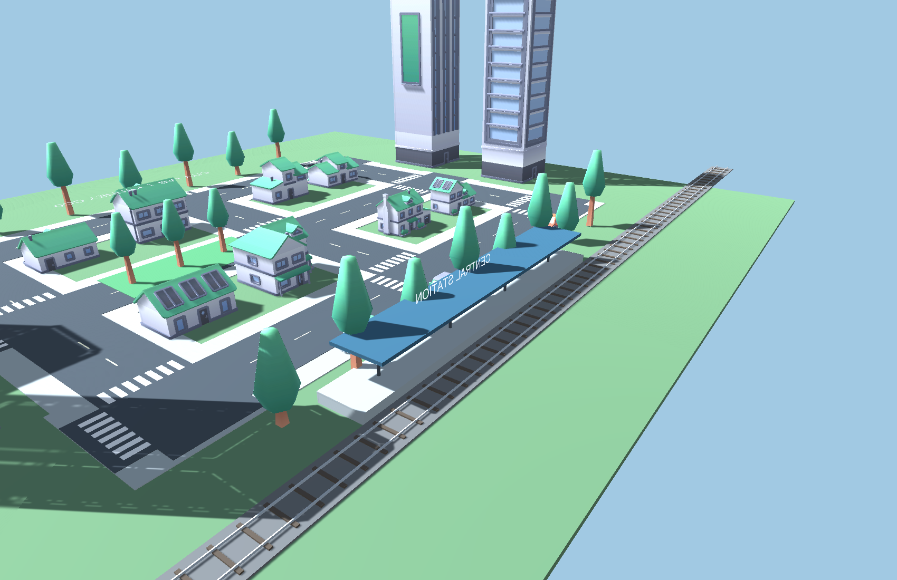
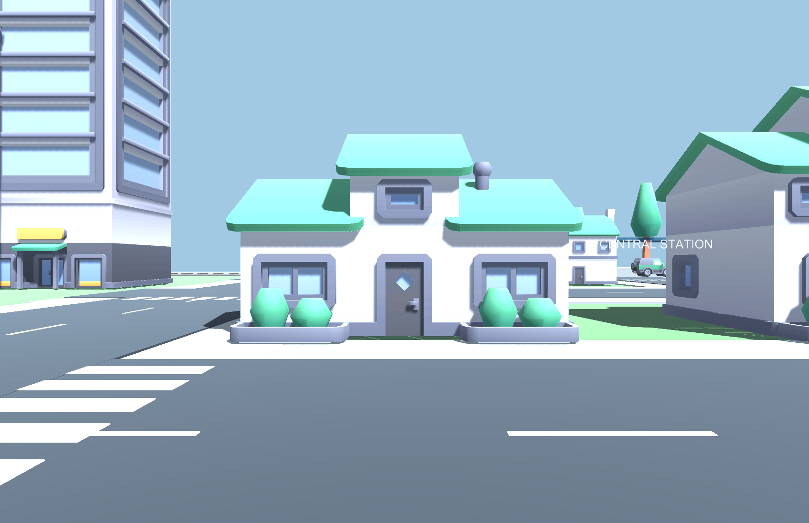
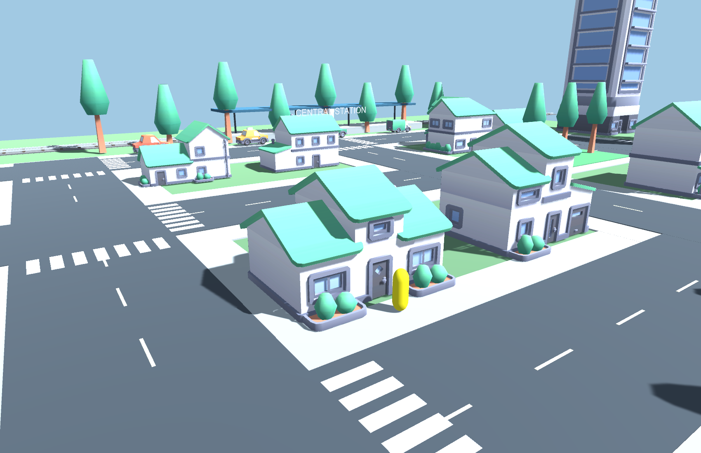

# Создание виртуального города

Отчёт по практическому занятию 4–5

Институт перспективных технологий и индустриального программирования

Кафедра индустриального программирования

Преподаватель Вострокнутов Игорь Евгеньевич

Выполнил ____________________   Группа ____________________

4 ноября 2026 года

### Цель и результат

Создать сцену виртуального города из бесплатных ассетов и настроить физические границы зданий. Подготовлен самостоятельный проект Unity 6000.4.6f1 со сценой Practical04_05.unity: жилые кварталы, офисные здания, дороги, переходы, зелёные насаждения, парковка и станция. Персонаж перемещается через CharacterController и не проходит сквозь стены.

Проект выполнен в Built-in Render Pipeline. Использованы реальные FBX-модели Kenney с лицензией CC0, а дорожная разметка, площадки и станция собраны из стандартных примитивов. Все изображения ниже получены непосредственно камерами созданной сцены Unity, без дорисовки интерфейса или результата.

<!-- page -->
## 1 Выбор и импорт бесплатных ассетов

С официального сайта Kenney скачаны три набора. В проект включены FBX-модели, палитры colormap.png и исходные файлы License.txt. Это позволяет перенести сцену на другой компьютер без повторной загрузки моделей.

| Набор | Состав и применение |
| --- | --- |
| City Kit Suburban | 40 FBX; жилые здания, деревья, ограждения и малые формы |
| City Kit Commercial | 41 FBX; коммерческие здания и офисные высотки |
| Car Kit | 50 FBX; автомобили и вспомогательные детали |
| Лицензия | Creative Commons Zero, CC0; разрешено учебное и коммерческое использование |

Всего импортирована 131 модель. В сцене использована часть набора: восемь жилых домов, четыре офисных здания, семнадцать деревьев и четыре припаркованных автомобиля. Материал Standard получает текстуру палитры соответствующего набора, поэтому цвета моделей сохраняются при использовании встроенного рендера.



Источники: [City Kit Suburban](https://kenney.nl/assets/city-kit-suburban), [City Kit Commercial](https://kenney.nl/assets/city-kit-commercial), [Car Kit](https://kenney.nl/assets/car-kit). Копии лицензий находятся внутри UnityProject/Assets/ThirdParty/Kenney.

<!-- page -->
## 2 Планировка кварталов и дорог

Город размещён на основании 118 × 106 единиц. Три горизонтальные улицы проходят при Z = −24, 0 и 24, три вертикальные — при X = −32, 0 и 32. Ширина проезжей части равна 8 единицам, общая полоса с тротуарами — 13. Такое разделение оставляет безопасное пространство для пешеходов.



Разметка создаётся тонкими светлыми прямоугольниками над поверхностью дороги. На перекрёстках добавлены переходы из семи полос. Дома расположены в свободных промежутках между улицами, а офисы вынесены к внешним границам кварталов. В этой работе город является учебной моделью, а не копией конкретного реального населённого пункта.



<!-- page -->
## 3 Жилые и деловые здания

Размер каждой импортированной модели нормализуется по большей из горизонтальных сторон. Для жилых домов задан размер 8 единиц, для офисов — 10. Соотношение высоты, ширины и глубины исходной модели сохраняется. После масштабирования нижняя граница визуальной модели совмещается с поверхностью площадки.





Для различимости кварталов используются разные варианты FBX. Объект здания содержит дочернюю визуальную модель и BoxCollider на корневом GameObject. Это отделяет физическую форму от детализации окон, крыш и декоративных элементов.

<!-- page -->
## 4 Парк и городское окружение

Вдоль внешних тротуаров размещены деревья, а в правой центральной зоне выделен небольшой парк. Зелёная площадка и деревья отделяют дворовую территорию от проезжей части. У деревьев также имеются простые ограничивающие коллайдеры; точное моделирование каждой ветви не требуется для прохода персонажа.





Автомобили в работе 4–5 статичны. Их назначение — дополнить городскую среду и продемонстрировать импорт моделей транспорта. Программное движение этих объектов реализуется отдельно в практической 6–7.

<!-- page -->
## 5 Станция и обзор сцены

На северной границе города подготовлена станция. Она состоит из платформы, опор, навеса, балластной полосы, шпал и двух рельсов. Длина видимого железнодорожного участка — 150 единиц. Эта часть окружения станет основой движения большого объекта в следующей работе.



В сцене четыре камеры: общий вид, камера пешехода, станция и карта сверху. F1–F4 переключают их, H скрывает памятку. Камера пешехода закреплена на объекте Walker на высоте 1,65 единицы. Применено направленное освещение с мягкими тенями и нейтральный фон неба.



<!-- page -->
## 6 Настройка коллайдеров

Для каждого здания создаётся BoxCollider по общим границам его Renderer. Корневой объект здания имеет единичный масштаб; дочерняя модель отвечает за визуальный размер и поворот. Поэтому центр коллайдера переводится в локальные координаты корня, а размер задаётся по полученному ограничивающему объёму.

| Компонент | Применение |
| --- | --- |
| Transform | Положение объектов, поворот моделей и масштаб |
| Mesh Renderer и Mesh Filter | Отображение импортированной геометрии |
| BoxCollider | Непроходимые статические здания и элементы окружения |
| CharacterController | Капсула персонажа с реакцией на стены |
| CityWalker | Перемещение с клавиатуры через CharacterController.Move |
| Prefab ResidentialBuilding | Сохранённый дом с визуальной моделью и коллайдером |

Rigidbody не добавляется ко всем зданиям: неподвижная геометрия корректно участвует в столкновениях как статические коллайдеры. Для пешехода выбран CharacterController, который ограничивает движение при контакте. Поскольку Move не применяет гравитацию автоматически, вертикальная скорость рассчитывается в CityWalker.



В физическом опыте капсула двигалась к первому дому 120 шагов по 1/60 секунды. Получен флаг CollisionFlags.Sides. Стена находится при Z = −18,16350, капсула остановилась при Z = −18,50850. Зазор 0,345 соответствует радиусу 0,32 и skinWidth 0,025. Эти значения записаны в collision.json. Жёлтая капсула на снимке показывает положение контрольного объекта после столкновения.

<!-- page -->
## 7 Программное управление персонажем

Скорость перемещения составляет 4 единицы в секунду. WASD задают направление, стрелки влево и вправо поворачивают персонажа. Вектор ограничен длиной 1, поэтому диагональное движение не даёт дополнительной скорости. Время кадра учитывается через dt.

Основной рабочий метод из CityWalker.cs:

```csharp
public CollisionFlags Step(Vector3 direction, float dt)
{
    if (!controller) controller = GetComponent<CharacterController>();
    verticalVelocity = controller.isGrounded
        ? -1f : verticalVelocity + Physics.gravity.y * dt;
    Vector3 movement = transform.TransformDirection(
        Vector3.ClampMagnitude(direction, 1f)) * speed;
    movement.y = verticalVelocity;
    return controller.Move(movement * dt);
}
```

В отличие от прямого изменения transform.position, CharacterController.Move выполняет проверку контактов и возвращает сведения о столкновении. Внутри здания персонаж не появляется после нажатия W; движение заканчивается перед препятствием.

Префаб дома находится в Assets/Prefabs/ResidentialBuilding.prefab. Его можно добавлять в сцену повторно с уже настроенным BoxCollider. Для объектов со сложными проходами следует использовать несколько простых коллайдеров или подходящий MeshCollider; один общий BoxCollider сознательно закрывает весь ограничивающий объём дома, включая возможные декоративные ниши.

### Воспроизведение

Добавить UnityProject в Unity Hub, открыть Practical04_05.unity и нажать Play. Выбрать F2 и щёлкнуть внутри Game для управления. Для повторной генерации использовать Practicals → Build city and evidence. Команда пересоздаёт сцену, изображения камер и журнал проверок.

<!-- page -->
## 8 Проверка и вывод

В Unity успешно выполнены десять проверок. Полный журнал находится в verification.txt.

| Проверка | Результат |
| --- | --- |
| Количество импортированных зданий | 12, PASS |
| BoxCollider у каждого здания | PASS |
| Статическая геометрия зданий | PASS |
| Импорт бесплатных FBX-моделей | PASS |
| Четыре камеры обзора | PASS |
| Ненулевые размеры визуальных моделей | PASS |
| Флаг столкновения со стеной | PASS |
| Невозможность пройти через дом | PASS |
| Свободное начальное пространство тротуара | PASS |
| Сохранение префаба дома с коллайдером | PASS |

Создан виртуальный город из бесплатных ассетов. Настроены визуальная геометрия, инфраструктура и физические границы. Опыт с капсулой подтверждает работу коллайдера действительным перемещением контроллера, а не только наличием компонента в списке. Сцена сохранена и может использоваться как основа для динамических объектов практической 6–7.

### Источники

1. Предоставленный файл «Практическое занятие 4-5.docx», Вострокнутов И. Е. Задание на создание виртуального города и настройку коллайдеров.

2. Kenney, [City Kit Suburban](https://kenney.nl/assets/city-kit-suburban), [City Kit Commercial](https://kenney.nl/assets/city-kit-commercial), [Car Kit](https://kenney.nl/assets/car-kit). Лицензии CC0 включены в проект. Дата обращения 04.11.2026.

3. Unity Technologies, [CharacterController.Move](https://docs.unity3d.com/jp/current/ScriptReference/CharacterController.Move.html). Дата обращения 04.11.2026.

4. Исходный проект UnityProject, скрипты Assets/Editor/CityBuilder.cs и Assets/Scripts/CityWalker.cs, verification.txt и collision.json.
