# Динамические объекты виртуального города

Отчёт по практическому занятию 6–7

Институт перспективных технологий и индустриального программирования

Кафедра индустриального программирования

Преподаватель Вострокнутов Игорь Евгеньевич

Выполнил ____________________   Группа ____________________

4 ноября 2026 года

### Цель и результат

Добавить в город практической 4–5 динамические объекты и задать их программное движение. Реализованы восемь автомобилей, восемь пешеходов и четырёхвагонный пассажирский поезд. Машины следуют по замкнутому маршруту, соблюдают дистанцию и уступают пешеходам на регулируемом переходе. Поезд подъезжает к станции, тормозит, стоит шесть секунд и отправляется.

Создан самостоятельный проект Unity 6000.4.6f1 со сценой Practical06_07.unity. Сохранены 15 детерминированных проверок и шесть проверок реального Play Mode, телеметрия за 60 секунд модельного времени и собственные изображения результатов. Это учебная кинематическая модель движения с правдоподобными скоростями и ускорениями, а не измерения реального транспортного объекта.

<!-- page -->
## 1 Основа города и организация компонентов

Геометрия кварталов, станция и коллайдеры перенесены из завершённой практической 4–5. Статические автомобили парковки сохранены. Динамические машины создаются отдельно из TrafficCar.prefab, а поезд использует PassengerTrain.prefab. Модель пешехода собрана из примитивов и имеет подвижные конечности.

| Компонент | Назначение |
| --- | --- |
| TrafficRoute | Образцы замкнутого пути и накопленная длина |
| TrafficCar | Дистанция, скорость и перемещение Rigidbody |
| PedestrianMover | Ходьба, ожидание и анимация конечностей |
| StationTrain | Расписание и кинематика поезда |
| CitySimulation | Общий фиксированный шаг и сигналы перехода |
| RuntimeVerification | Отдельная проверка настоящего Play Mode |

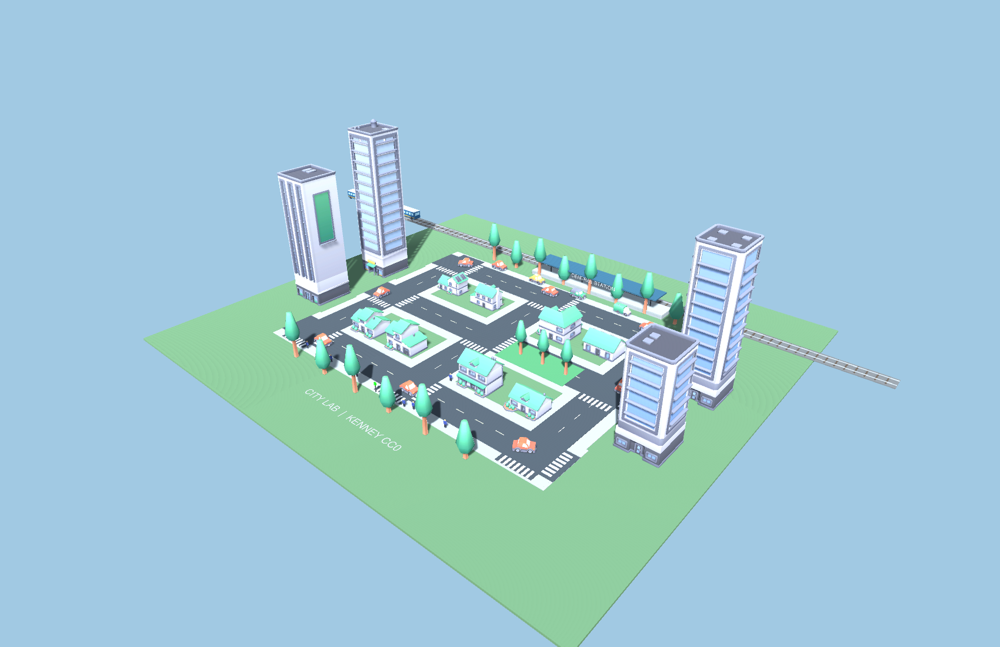

В сохранённой сцене список cars пуст. При запуске Start вызывает Initialize и создаёт восемь экземпляров через Instantiate. Повторный вызов Initialize не дублирует уже созданные машины. Это поведение отдельно подтверждено в Play Mode.

<!-- page -->
## 2 Маршрут автомобилей

Маршрут проходит по внешнему кольцу улиц и состоит из прямых и четырёх дуг радиусом 8 м. На прямых шаг дискретизации не больше 0,5 м, каждая дуга разделена на 32 участка. По накопленной длине определяется положение машины; направление задаётся касательной текущего участка.

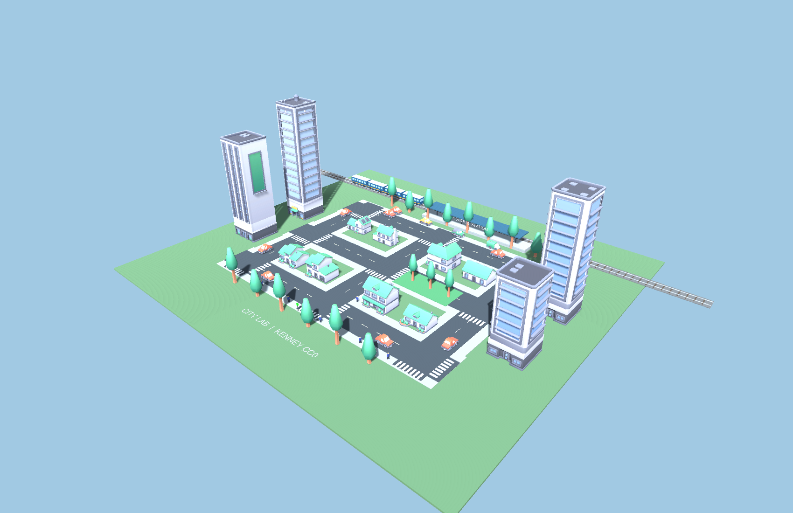

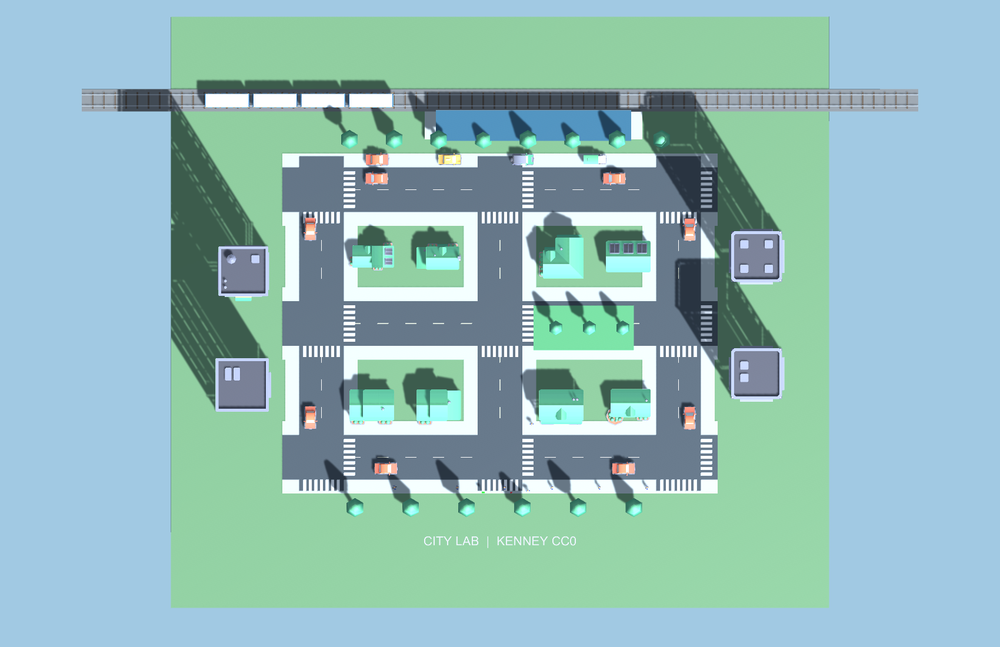

Путь имеет непрерывное положение при переходе между участками и замыкается без скачка координат. Максимальная скорость на прямой — 8 м/с, то есть 28,8 км/ч. При повороте ограничение снижается до 4 м/с. Начальные позиции восьми машин равномерно распределены по длине кольца.

<!-- page -->
## 3 Разгон торможение и дистанция

Скорость меняется постепенно: ускорение ограничено 2 м/с², торможение — 4 м/с². Шаг пути рассчитывается по средней скорости до и после обновления, а не по постоянному приращению позиции за кадр. Компонент Rigidbody настроен как Kinematic с Interpolate и Continuous Speculative.

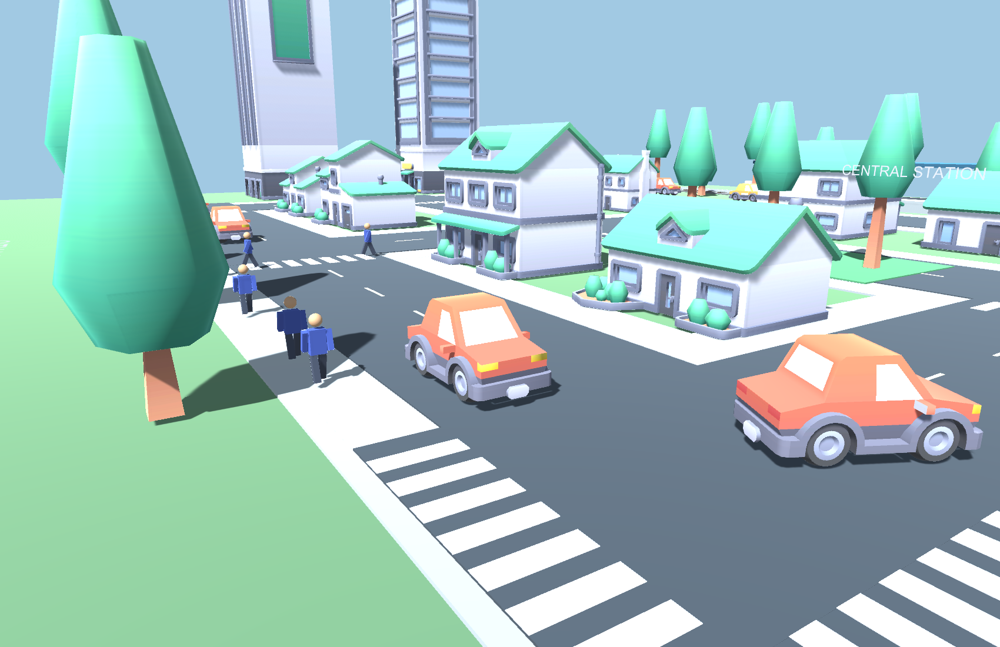

Перед шагом для всех машин вычисляются целевые скорости. Ограничение учитывает ближайшую впереди машину и расстояние до стоп-линии. Для торможения используется зависимость v = √(2ad), где d — доступный тормозной путь. Запас между центрами машин задан как 7 м. В опыте фактический минимум составил 6,870826 м из-за дискретного шага управления; это выше контрольной границы 5 м и не привело к пересечению коллайдеров.

Рабочее обновление из TrafficCar.cs:

```csharp
float previous = speed;
speed = Mathf.MoveTowards(speed, Mathf.Max(0, targetSpeed),
    (targetSpeed < speed ? braking : acceleration) * dt);
distance = Mathf.Repeat(
    distance + (previous + speed) * 0.5f * dt, route.Length);
route.Pose(distance, out var position, out var rotation);
body.MovePosition(position);
body.MoveRotation(rotation);
```

В реальном запуске этот путь вызывается из FixedUpdate с Time.fixedDeltaTime. Для воспроизводимых опытов тот же Step принимает dt явно; позиции Rigidbody задаются напрямую только в режиме ручного тестового шага.

<!-- page -->
## 4 Регулируемый переход

Автомобильная стоп-линия расположена перед переходом. Цикл сигналов имеет период 24 секунды. Машинам разрешено движение в начале цикла и после 20-й секунды; пешеходам разрешён вход на переход с 12-й по 18-ю секунду. Между сменой автомобильного сигнала и началом перехода оставлены две секунды для освобождения зоны.

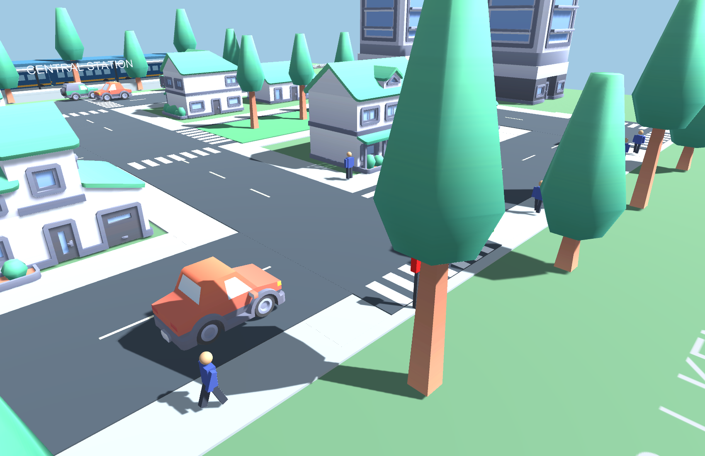

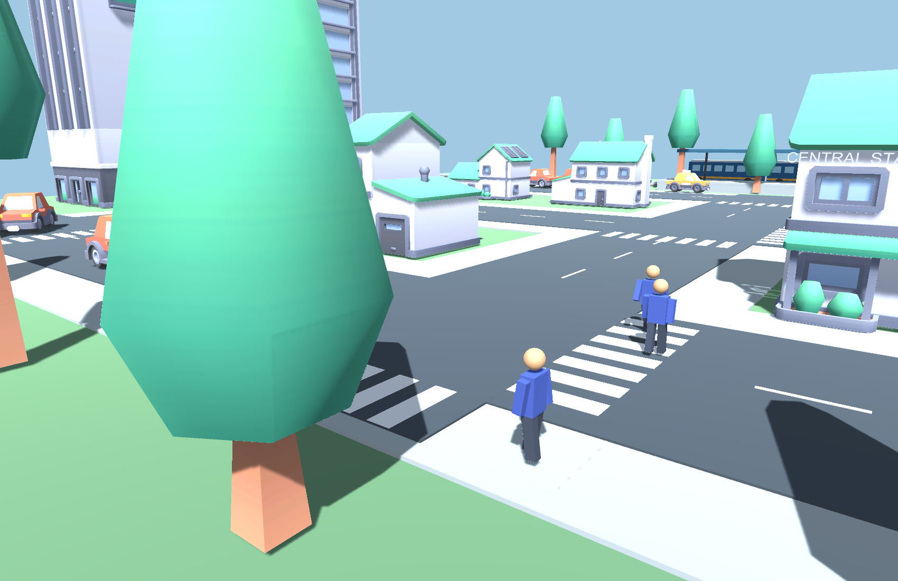

Если пешеход ещё находится между концами перехода, автомобильный зелёный не включается независимо от номинального расписания. Таким образом, человек, начавший переход ближе к концу разрешённой фазы, может закончить его безопасно. В 60-секундном опыте физическая проверка ComputePenetration не обнаружила пересечений автомобильных BoxCollider с капсулами пешеходов в проверенных выборках.

<!-- page -->
## 5 Пешеходы и анимация ходьбы

Шесть пешеходов перемещаются по широкому южному тротуару, двое используют регулируемый переход. Скорость ходьбы равна 1,35 м/с. На концах маршрута предусмотрена пауза две секунды и движение обратно. Поворот ограничен 180 градусами в секунду, поэтому направление не меняется мгновенно на 180 градусов.

Голова, корпус, руки и ноги созданы как отдельные части модели. Руки и ноги вращаются вокруг верхних опорных точек. Синусоидальное движение противоположных конечностей имитирует шаг; при ожидании углы возвращаются в нейтральное положение.

```csharp
phase += moving ? dt * 7f : 0f;
float angle = moving ? Mathf.Sin(phase) * 25f : 0f;
leftLeg.localRotation = Quaternion.Euler(angle, 0, 0);
rightLeg.localRotation = Quaternion.Euler(-angle, 0, 0);
leftArm.localRotation = Quaternion.Euler(-angle, 0, 0);
rightArm.localRotation = Quaternion.Euler(angle, 0, 0);
```

### Создание экземпляров машин

```csharp
for (int i = 0; i < carCount; i++)
{
    var car = Instantiate(carPrefab, transform);
    car.name = "TrafficCar_" + i;
    car.route = route;
    car.Place(i * route.Length / carCount);
    cars.Add(car);
}
```

Объектный пул не требуется для данного фиксированного числа машин: экземпляры создаются один раз, затем продолжают движение по кольцу. Пешеходы и поезд находятся в сохранённой сцене. Навигационная сетка NavMesh не используется, поскольку маршруты заданы явно и не проходят сквозь здания.

<!-- page -->
## 6 Большой объект и подход к станции

В качестве большого объекта выбран пассажирский поезд из четырёх секций. Общая длина около 33,8 м существенно больше длины автомобиля 4,2 м. Секции имеют корпус, окна, крышу, цветную полосу, коллайдеры и колёса. Поезд создан для работы из примитивов Unity и не приписывается набору Kenney.

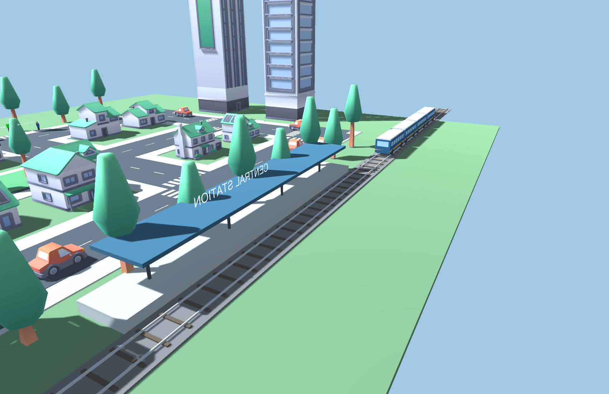

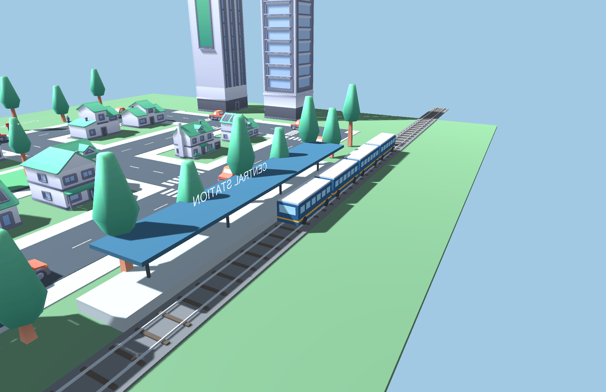

Головная секция движется от X = −70 до остановочной координаты X = 18. Максимальная скорость — 10 м/с, ускорение и торможение — 1,5 м/с². Участки траектории рассчитываются аналитически по времени, чтобы скорость не обнулялась скачком при достижении платформы.

<!-- page -->
## 7 Остановка и отправление поезда

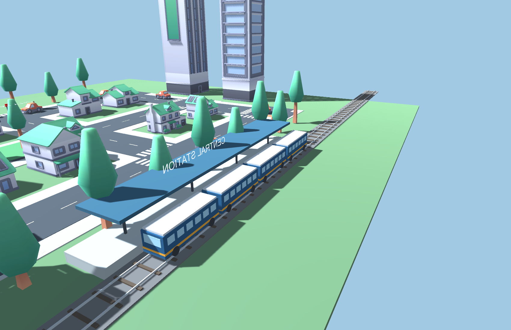

Во время Dwell скорость строго равна нулю, координата X сохраняется равной 18. Продолжительность стоянки — шесть секунд. После этого состояние меняется на Depart, и поезд снова плавно набирает скорость.

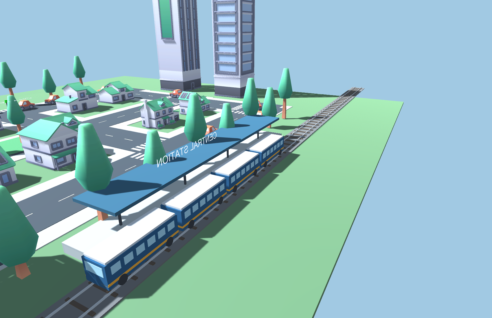

Колёса поворачиваются на угол, соответствующий пройденному расстоянию: Δφ = vΔt/r. Радиус колеса равен 0,45 м. Положение вагонов относительно головной секции остаётся постоянным, поскольку путь прямолинейный. После ухода всего состава за границу города объект возвращается в начальную точку за пределами демонстрируемой области и начинает новый цикл.

<!-- page -->
## 8 Проверка в настоящем Play Mode

Дополнительно к тестовому шагу выполнен отдельный запуск редактора в игровом режиме. Система отработала более 27 секунд собственного модельного времени. RuntimeVerification подтвердил создание восьми машин в Start, изменение реальных позиций через FixedUpdate и работу паузы.


Эти два изображения получены камерами работающего Play Mode, а предыдущие контрольные кадры — при воспроизводимом вызове тех же методов Step в Unity. Во время паузы модельное время сохранялось неизменным. После возобновления поезд дошёл до стоянки и продолжил движение.

<!-- page -->
## 9 Телеметрия и проверка правдоподобия

Файл telemetry.csv содержит состояние системы раз в секунду при фиксированном шаге 0,02 с в течение 60 секунд. Поля включают время, координату и скорость поезда, фазу движения, дистанцию и скорость первой машины и сигналы перехода. Это данные выполненного запуска модели в Unity.

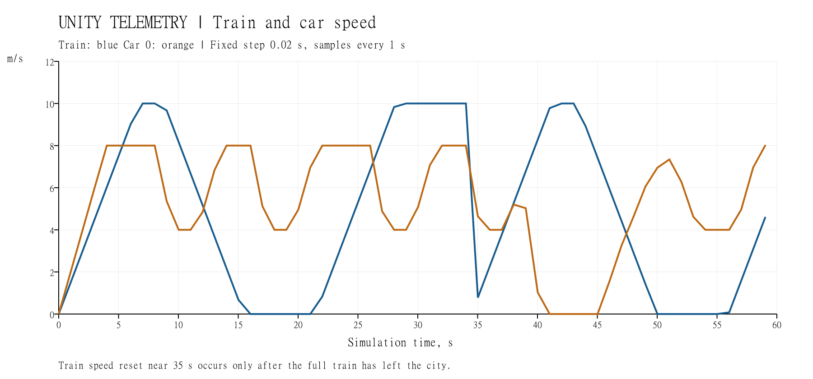

| Показатель | Результат |
| --- | --- |
| Минимальный промежуток между центрами машин | 6,870826 м |
| Наибольшее модульное ускорение поезда в рейсе | 1,500034 м/с² с учётом float |
| Максимальная скорость машины | 8 м/с на прямой, 4 м/с на повороте |
| Максимальная скорость поезда | 10 м/с |
| Стоянка у станции | 6 с |
| Автомобильные и пешеходные пересечения коллайдеров | Не обнаружены в проверенных выборках |

На графике около 35-й секунды скорость поезда возвращается к нулю при повторном использовании объекта за пределами города. Этот переход не включён в оценку ускорения видимого рейса. Внутри показанного движения разгон и торможение ограничены заданными параметрами; возврат за пределами города служит повторению демонстрации.

<!-- page -->
## 10 Кинематический расчёт поезда

При ускорении a = 1,5 м/с² и скорости v = 10 м/с время разгона равно v/a = 6,667 с. Путь разгона составляет v²/(2a) = 33,333 м. Столько же требуется для торможения. Из полного пути 88 м оставшиеся 21,333 м проходят с постоянной скоростью за 2,133 с.

Прибытие происходит примерно через 15,467 с модельного времени, отправление начинается после 21,467 с. Положение и скорость непрерывны на границах участков; ускорение меняется ступенчато, поэтому модель не учитывает ограничение рывка реального пассажирского состава.

Фрагмент аналитического торможения из StationTrain.cs:

```csharp
float accelerationTime = maxSpeed / acceleration;
float brakingTime = maxSpeed / braking;
float accelerationDistance = maxSpeed * maxSpeed / (2 * acceleration);
float brakingDistance = maxSpeed * maxSpeed / (2 * braking);
float cruiseTime =
    (stopX + 70 - accelerationDistance - brakingDistance) / maxSpeed;
float arrival = accelerationTime + cruiseTime + brakingTime;

// During the braking phase
float remaining = arrival - tripTime;
speed = braking * remaining;
positionX = stopX - 0.5f * braking * remaining * remaining;
```

В отличие от прибавления постоянного числа к координате каждый кадр, такая модель имеет скорости в метрах в секунду и ускорения в метрах в секунду в квадрате. Для настоящего цифрового двойника параметры следовало бы получить из характеристик реального состава или телеметрии; в учебной сцене они выбраны для демонстрации.

<!-- page -->
## 11 Детерминированные проверки

В verification.txt записаны 15 результатов PASS. Код проверки находится в DynamicCityBuilder.cs. Физические пересечения автомобилей проверялись раз в 50 шагов, автомобилей и пешеходов — раз в 25 шагов. Проверка выборочная и не заменяет непрерывный анализ всех возможных сценариев.

| Проверка | Результат |
| --- | --- |
| Создание восьми машин из префаба | PASS |
| Kinematic Rigidbody автомобилей | PASS |
| Восемь пешеходов с анимацией | PASS |
| Префаб большого поезда | PASS |
| Стоянка не короче шести секунд | PASS |
| Изменение дистанции машин | PASS |
| Перемещение пешеходов по тротуару | PASS |
| Дистанция между машинами больше 5 м | PASS |
| Отсутствие пересечений машин | PASS |
| Отсутствие пересечений машин и пешеходов | PASS |
| Остановка машин перед красным | PASS |
| Подъезд торможение стоянка отправление | PASS |
| Ускорение поезда меньше 2 м/с² | PASS |
| Повторение полного рейса | PASS |
| События остановки и отправления | PASS |

Движение физически задаётся кинематикой, а не силами двигателя и подвески. Поэтому сцена не моделирует заносы, сцепление шин, повреждения, реакцию на произвольно добавленное препятствие или перестроение между полосами. Она решает поставленную задачу движения по заранее подготовленному городу.

<!-- page -->
## 12 Проверка запуска и вывод

| Проверка настоящего Play Mode | Результат |
| --- | --- |
| Start создаёт восемь автомобилей | PASS |
| FixedUpdate изменяет положения машин | PASS |
| FixedUpdate изменяет время движения поезда | PASS |
| Пауза останавливает модельное время | PASS |
| Поезд реально стоит у платформы | PASS |
| Поезд отправляется после стоянки | PASS |

Выполнены оба задания практической 6–7. В город добавлены движущиеся автомобили и люди; их перемещение, ожидание и взаимодействие с сигналами определяются кодом. Большой объект представлен поездом с последовательностью подъезда, остановки и отправления. Проверено 21 условие: 15 в воспроизводимом опыте и шесть в настоящем игровом запуске.

### Запуск и повторение

Открыть UnityProject в Unity Hub, сцену Assets/Scenes/Practical06_07.unity и нажать Play. F1 — общий вид, F2 — пешеход, F3 — станция, F4 — карта. Space ставит симуляцию на паузу и возобновляет её. Памятка скрывается H. Для ввода нужно щёлкнуть внутри Game.

Меню Practicals → Build dynamic city and evidence пересоздаёт сцену, десять контрольных кадров, verification.txt, telemetry.csv и metrics.json. RuntimeVerification.Begin запускает отдельную проверку Play Mode с двумя дополнительными изображениями и runtime-verification.txt. График построен из сохранённой телеметрии. Перед пересозданием сохранить свои изменения сцены под другим именем.

### Источники

1. Предоставленное задание «Практическое занятие 6-7.docx», Вострокнутов И. Е. Динамические объекты и движение большого объекта в городе работы 4–5.

2. [Kenney City Kit Suburban](https://kenney.nl/assets/city-kit-suburban), [City Kit Commercial](https://kenney.nl/assets/city-kit-commercial), [Car Kit](https://kenney.nl/assets/car-kit). Копии лицензий CC0 включены в проект. Ссылки и авторство приведены в ASSETS.md.

3. Unity Technologies, [Rigidbody.MovePosition](https://docs.unity3d.com/jp/current/ScriptReference/Rigidbody.MovePosition.html). Дата обращения 04.11.2026.

4. Исходные скрипты UnityProject/Assets/Scripts, редакторские проверки в Assets/Editor, журналы verification.txt и runtime-verification.txt, данные telemetry.csv и metrics.json.
