# Практическая работа 8–9

## Порталы и взаимодействие с предметами в Unity

Отчёт описывает расширение виртуального города из работы 6–7: переход в отдельную комнату, перемещение мебели, перенос небольших предметов и управление освещением. Реализована одна сцена с двумя пространственно разделёнными областями. Два портала перемещают персонажа между городом и комнатой.

Выполнил: ____________________  Группа: ____________________

Среда: Unity 6000.4.6f1, Built-in Render Pipeline, C#, Input Manager. Исходное задание сохранено в assignment.docx. Иллюстрации получены рендерингом реальной сцены Unity; кадры 10–12 сняты во время Play Mode. Это изображения камер, а не фотографии физического помещения.


Созданы два стола, четыре стула, два открытых шкафа, девять небольших предметов, четыре светильника и настенный выключатель. Сохранились транспорт, пешеходы и поезд исходного города.

<!-- page -->
## Запуск и управление

Добавить UnityProject в Unity Hub, открыть Assets/Scenes/Practical08_09.unity и нажать Play. Щёлкнуть внутри Game для клавиатурного ввода. Персонаж расположен перед голубой рамой портала; движение вперёд приводит в комнату. Оранжевая рама внутри комнаты возвращает в город.

| Клавиши | Действие |
|---|---|
| WASD | Перемещение персонажа |
| Стрелки влево и вправо | Поворот персонажа |
| Page Up и Page Down | Наклон камеры для выбора предмета |
| E | Действие с объектом под прицелом |
| R | Отпустить удерживаемый предмет |
| F1 F2 F3 F4 F5 | Город, персонаж, станция, карта, комната |
| H | Скрыть справку города |

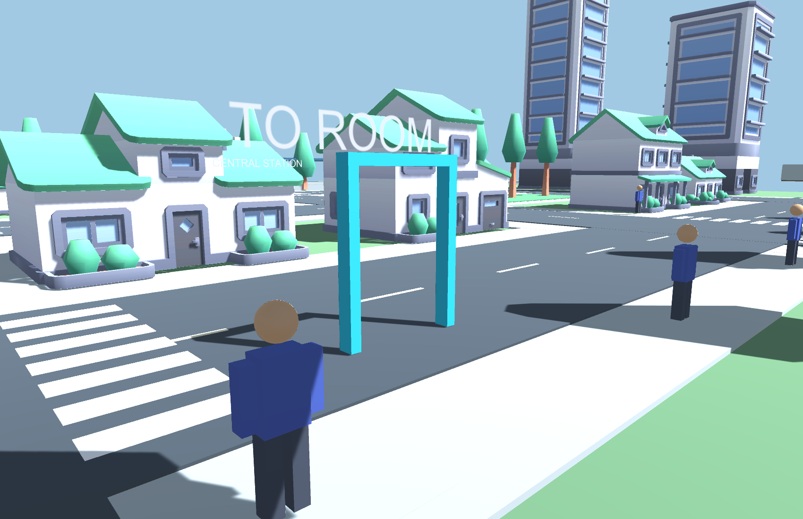

Для работы с предметами включить F2. Обзор F5 предназначен для осмотра комнаты. Для сдвига стула или стола подойти к нему вплотную и продолжить движение.

<!-- page -->
## Построение комнаты

Комната находится около координаты X = 160 м, за пределами городской площадки. Размер пола составляет 14 × 12 м, высота стен — 4,2 м. Пол, потолок, стены и перемычка над выходом имеют BoxCollider. В южной стене оставлен проход шириной 2,4 м.

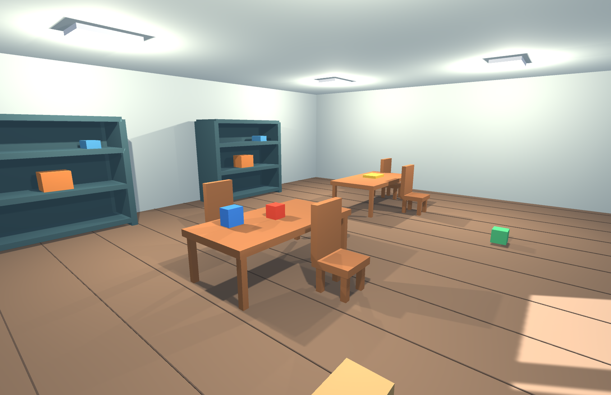

Геометрия мебели и помещения создана из примитивов. Такое решение позволяет явно задать размеры и форму каждого физического препятствия. На полу показаны швы досок; эти декоративные полосы не имеют коллайдеров. Визуальные световые панели также не создают лишних физических препятствий.

Город использует ранее импортированные бесплатные модели Kenney. Список источников и лицензии находятся в ASSETS.md и Assets/ThirdParty/Kenney. Комната и её предметы созданы непосредственно для этой работы.

<!-- page -->
## Коллайдеры мебели и шкафов

Столы и стулья состоят из столешницы или сиденья, ножек и спинки. На корневом объекте каждой единицы мебели установлен один динамический Rigidbody; дочерние BoxCollider образуют составное физическое тело. Масса стола равна 20 кг, стула — 6 кг. Используются интерполяция и ContinuousDynamic.

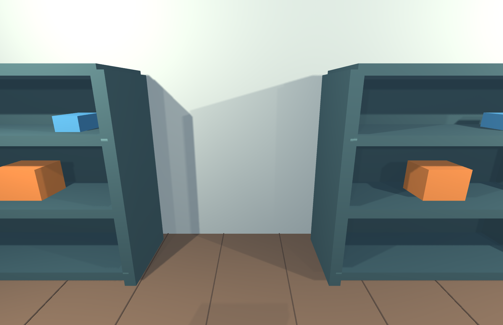

Полки шкафа имеют отдельные коллайдеры. Поэтому предмет удерживается именно полкой, а свободное пространство между полками остаётся доступным для луча взаимодействия. В этой работе шкафы открытые; вращающиеся двери добавляются в следующей практической.

RoomInteractor получает OnControllerColliderHit от CharacterController и прикладывает горизонтальную силу 35 Н к динамическому телу. Вертикальные столкновения при падении исключены из этого обработчика. Гравитация, контакт с полом и взаимные столкновения мебели рассчитываются физикой Unity.

<!-- page -->
## Предметы и перенос

Небольшие объекты размещены на обоих столах, внутри шкафов и на полу. Каждый имеет PortableItem, Rigidbody и BoxCollider. Масса по умолчанию — 0,35 кг. Дальность взаимодействия ограничена 3,5 м.

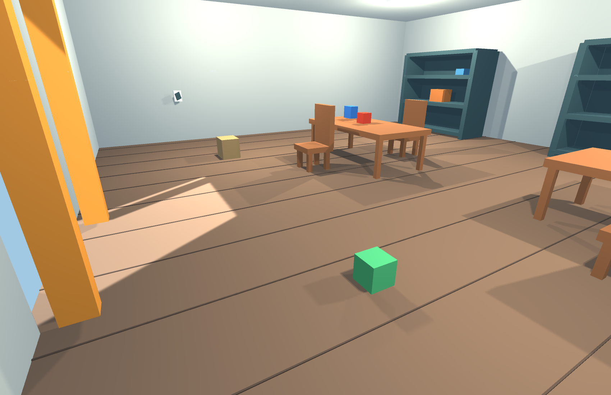

По нажатию E луч выходит из камеры через центр экрана. Выбирается ближайший непрозрачный для луча коллайдер; триггеры порталов игнорируются. Дополнительная проверка видимости в Take предотвращает выбор предмета через стену при программном вызове метода.

При переносе тело временно становится кинематическим, а столкновение с персонажем отключается. Целевая точка расположена на 1,5 м впереди камеры. SweepTest ограничивает движение удерживаемого тела при препятствии. R восстанавливает динамику и столкновение с персонажем; затем предмет снова падает и опирается на поверхности. Переход через портал автоматически отпускает предмет.

<!-- page -->
## Настенный выключатель

Выключатель установлен на западной стене на высоте 1,4 м. Он состоит из основания с коллайдером и видимой клавиши. Чтобы изменить свет, подойти, направить прицел на основание и нажать E. Тот же луч взаимодействия обслуживает выключатель и предметы.

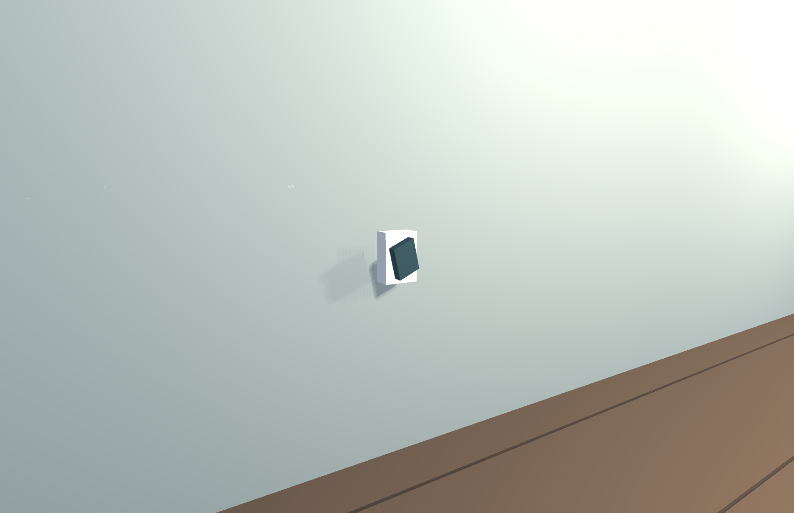

RoomLightSwitch хранит массив четырёх Point Light. Toggle меняет логическое состояние и свойство enabled каждого светильника; клавиша также меняет наклон. Состояние не зависит от выбранной обзорной камеры.

Светильники находятся под потолком, используют тёплый оттенок и мягкие тени. В сцене остаются общее освещение города и свет из дверного проёма. Поэтому выключение потолочных источников уменьшает освещённость, но не создаёт абсолютную темноту. Это отражено в паре кадров следующей страницы.

<!-- page -->
## Сравнение освещения

Камера и предметы на двух кадрах имеют одинаковое положение. Между сохранениями изменено только состояние четырёх комнатных источников света.

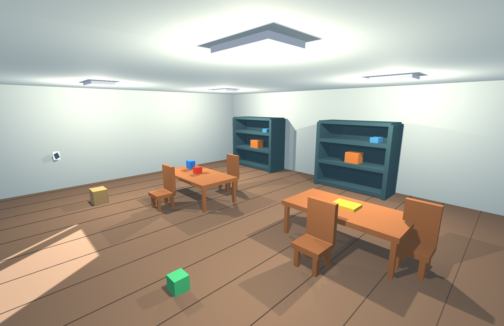

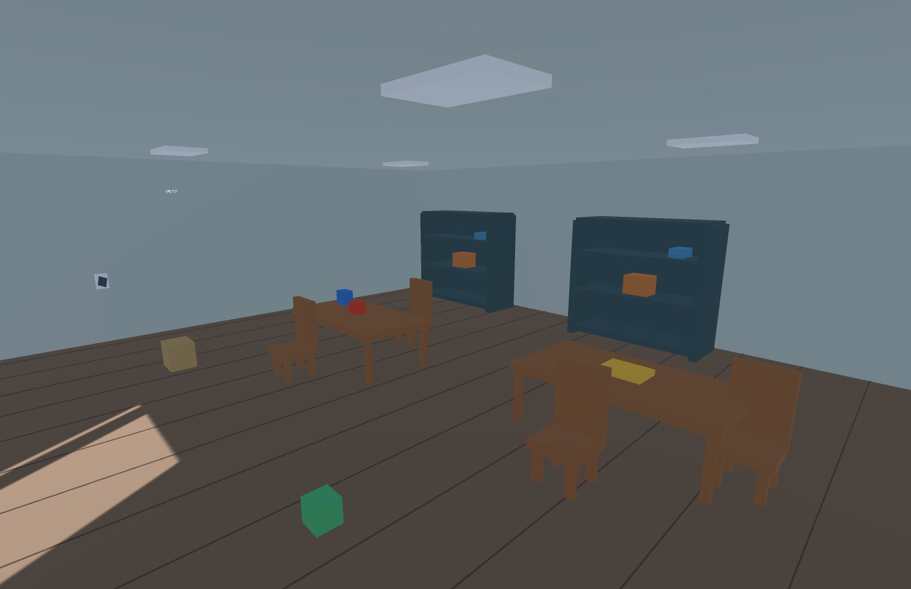

Проверка сборки подтверждает выключение всех четырёх Light. Проверка Play Mode дополнительно вызывает переключатель во время выполнения сцены.

<!-- page -->
## Переходы между областями

PortalDoor содержит BoxCollider с isTrigger и кинематический Rigidbody без гравитации. Стойки рамы имеют обычные коллайдеры. Вход CharacterController в объём триггера обрабатывается OnTriggerEnter и OnTriggerStay. В FixedUpdate дополнительно запрашиваются пересечения того же BoxCollider, чтобы поддержать перемещение контроллера из редакторского теста. Все пути вызывают единый метод Enter.

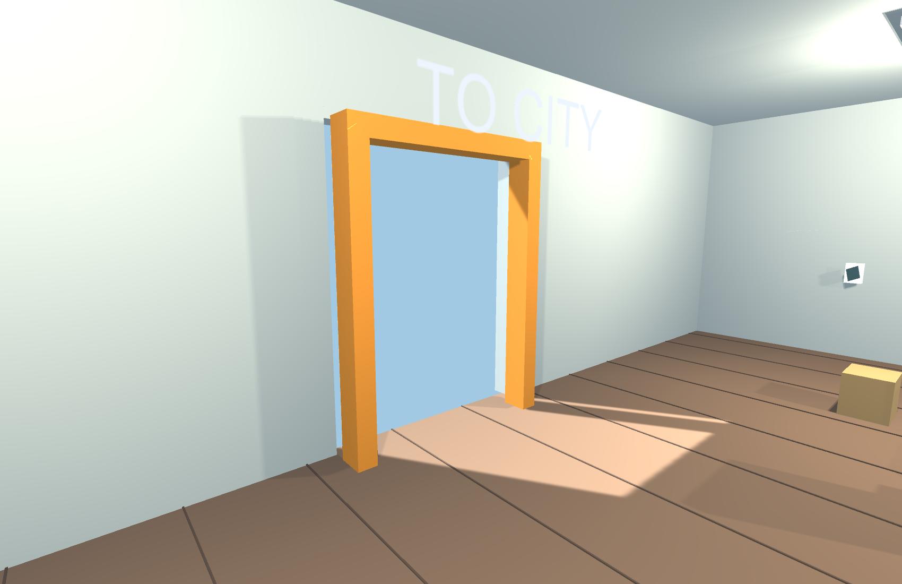

Для телепортации контроллер кратковременно отключается, Transform получает положение и ориентацию точки назначения, затем контроллер снова включается. Камера переключается на вид персонажа. Точки прибытия находятся перед рамами, чтобы не оставлять персонажа внутри триггера.

Общий интервал блокировки равен одной секунде. Он предотвращает немедленное возвращение через второй портал. Перед переносом вызывается Drop, поэтому удерживаемое физическое тело остаётся в прежней области. Это осознанное правило взаимодействия: для переноса между областями требуется отдельная реализация сопровождения груза.

<!-- page -->
## Проверка входа в Play Mode

В RoomRuntimeVerification запускается настоящая сохранённая сцена. Сначала проверяется создание восьми автомобилей исходной модели. Затем CharacterController последовательно перемещается через городской портал. Тест ожидает изменения координаты X из городской области в комнатную.

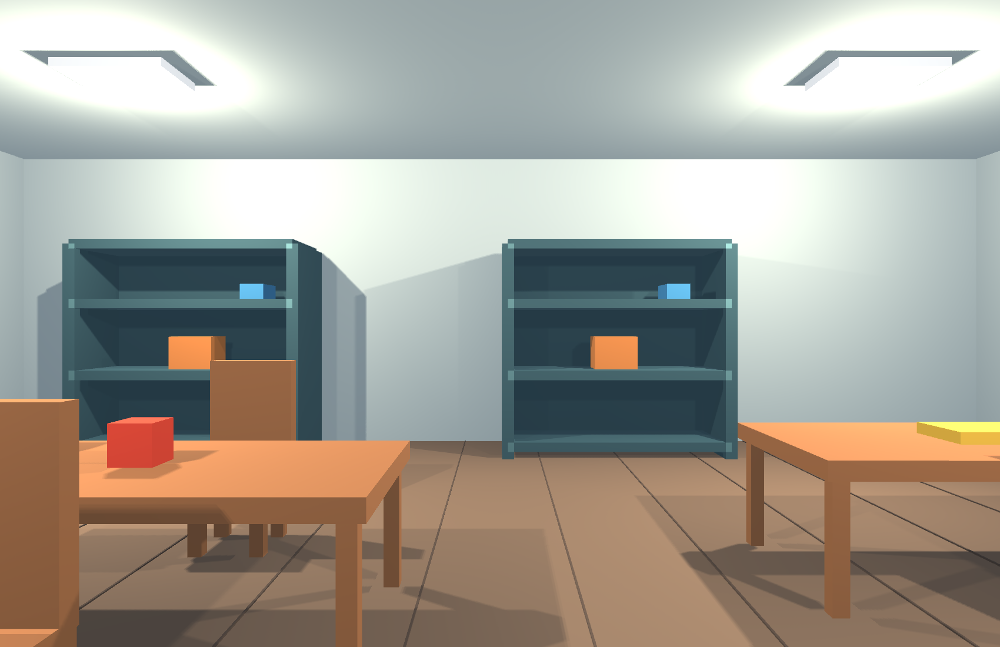

Сразу после прибытия программно проверяется повторная попытка входа: cooldown должен её отклонить. Далее переключается свет и выбирается предмет лучом. Проверки используют реальные компоненты сцены и игровые методы, которые обслуживают клавишу E. Автоматическая проверка не имитирует физическое нажатие клавиатуры.

Кадр сохранён непосредственно после фактического срабатывания триггера. Он подтверждает наличие комнаты и правильную позицию камеры после перехода.

<!-- page -->
## Проверка переноса и физики

Тест направляет камеру на красный куб, вызывает Interact и перемещает персонажа. Проверяется изменение положения куба более чем на 0,3 м и кинематическое состояние удерживаемого Rigidbody. После Drop проверяется восстановление динамики.

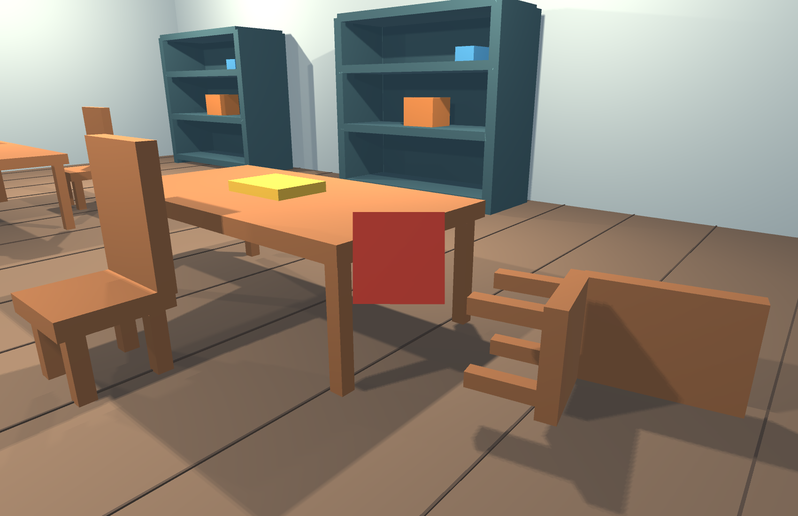

Отдельная проверка прикладывает к столу горизонтальный импульс 40 Н·с. Через одну секунду его положение должно сместиться более чем на 0,05 м. Таким способом проверяется участие составного тела в физическом расчёте. Пользовательское толкание работает через OnControllerColliderHit; автоматический тест мебели проверяет отклик на импульс, а не воспроизводит клавишу движения.

В проекте нет принудительного перемещения мебели через Transform в игровом режиме. Мебель двигает Rigidbody, а переносимые предметы временно переводятся в режим удерживания.

<!-- page -->
## Проверка возврата в город

После отпускания предмета персонаж размещается перед внутренней рамой и проходит через её триггер. Тест ожидает возвращения координаты X в городскую область. Фиксируется ещё один кадр игровой камеры.

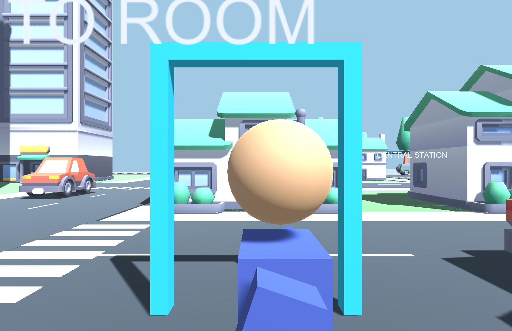

Город и комната находятся в одной сцене, поэтому переход не вызывает загрузку SceneManager. Автомобили, пешеходы и поезд продолжают существовать. Такой способ подходит для небольшой учебной сцены и позволяет проверять обе области одним запуском.

Для больших помещений и множества интерьеров целесообразны отдельные сцены и аддитивная загрузка. В данной работе это не требуется: задача сосредоточена на триггерах, коллайдерах и взаимодействии с предметами.

<!-- page -->
## Результаты и воспроизведение

Журнал verification.txt содержит четыре проверки сборки: два портала, девять предметов, динамическое тело стола и выключение источников света. runtime-verification.txt содержит девять проверок Play Mode: городской транспорт, переход в комнату, блокировку возврата, переключение света, выбор предмета, перенос, отпускание, реакцию мебели и обратный переход.

Основные файлы реализации:

| Файл | Назначение |
|---|---|
| PortalDoor.cs | Триггер, перенос контроллера и cooldown |
| RoomInteractor.cs | Луч, перенос, отпускание и толкание |
| PortableItem.cs | Маркер переносимого предмета |
| RoomLightSwitch.cs | Состояние потолочного освещения |
| RoomBuilder.cs | Построение комнаты и сохранение кадров |
| RoomRuntimeVerification.cs | Проверки сохранённой сцены в Play Mode |

Ключевая последовательность телепортации:

```csharp
walker.enabled = false;
walker.transform.SetPositionAndRotation(
    destination.position, destination.rotation);
walker.enabled = true;
lastTeleport = Time.time;
```

Повторная генерация доступна через Practicals → Build room and evidence. Она открывает исходный город 6–7 и пересоздаёт комнату, итоговую сцену и первые девять иллюстраций. Play Mode проверяется отдельно командой -executeMethod RoomRuntimeVerification.Begin в batchmode; она обновляет журнал и кадры 10–12. Собственные изменения сцены перед генерацией следует сохранить под отдельным именем.

Ограничения модели: предметы представлены простыми телами; хват не моделирует пальцы и шарнир руки; обзорные кадры получены камерами Unity. Задания на порталы, мебель, перенос предметов и переключение освещения реализованы в самостоятельном проекте.

