# Практическая работа 10–11

## Вращающиеся механизмы интерактивной комнаты

В комнате из работы 8–9 реализованы двери шкафов, входная дверь, настольный вентилятор и жалюзи. Двери сохраняют физические коллайдеры при повороте. Предметы внутри шкафа доступны только при открытой двери. Воздушный поток вентилятора прикладывает силу к лёгким телам и сдувает их со стола.

Выполнил: ____________________  Группа: ____________________

Среда выполнения: Unity 6000.4.6f1, C#, Built-in Render Pipeline. Проект самостоятельный и содержит исходные город и комнату для повторной генерации. Условия задания находятся в assignment.docx.

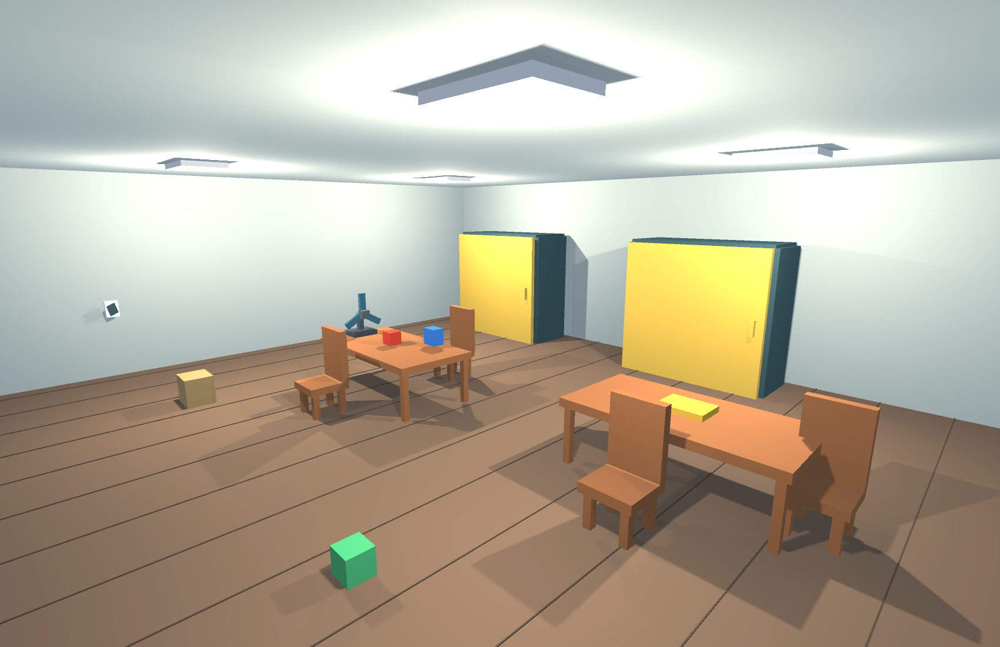

В отчёте приведены 12 изображений реальных камер Unity. Кадры 09–12 получены в Play Mode; остальные показывают подготовленные состояния этой же сцены. Результаты проверок сохранены отдельно от текста отчёта.

<!-- page -->
## Запуск и клавиши управления

Открыть UnityProject в Unity Hub, выбрать Assets/Scenes/Practical10_11.unity и нажать Play. Щёлкнуть Game. Подойти к городскому порталу, пройти в комнату и включить F2. Механизмы комнаты доступны из игровой камеры; F5 включает обзор помещения.

| Клавиша | Действие |
|---|---|
| WASD и стрелки | Движение и поворот персонажа |
| Page Up и Page Down | Наклон камеры |
| O | Открыть или закрыть дверь под прицелом |
| E | Взять видимый предмет или нажать выключатель |
| R | Отпустить удерживаемый предмет |
| F | Включить или выключить вентилятор |
| B | Поднять или опустить жалюзи |
| F1 F2 F3 F4 F5 | Город, персонаж, станция, карта, комната |

Дверь выбирается лучом на расстоянии до 3,5 м. Для повторного действия после её поворота нужно снова направить прицел на створку. При открывании отойти от траектории её движения: вращающийся коллайдер способен оттолкнуть CharacterController.

Вентилятор и жалюзи переключаются клавишами F и B без выбора лучом. Выключатель света и перенос предметов используют прежнее управление. Клавиша O выделена для дверей, чтобы нажатие E на предмете не вызывало одновременно открывание шкафа.

<!-- page -->
## Шкафы в закрытом и открытом состоянии

Каждый из двух шкафов получил одну широкую створку с боковой осью. Размер створки — 2,8 × 2,7 м. Внутренние полки и четыре предмета сохранены из предыдущей работы. Ниже показан один ракурс до и после поворота.

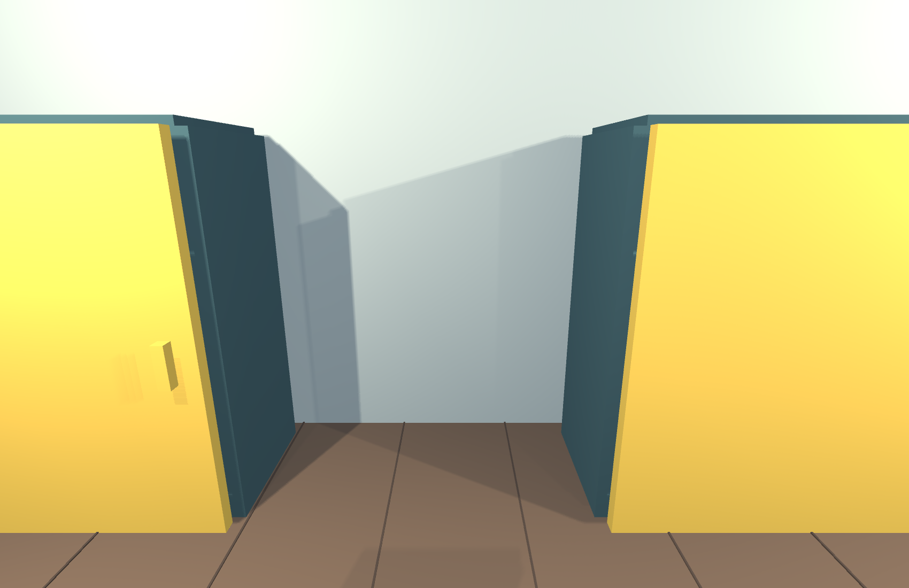

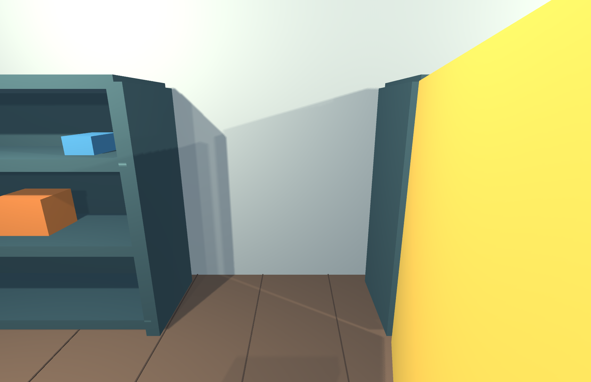

Коллайдеры створки и ручки входят в состав кинематического Rigidbody оси. Открывание выполняется вращением, а не отключением препятствия.

<!-- page -->
## Входная дверь

Входная створка занимает дверной проём шириной 2,3 м и высотой 3,1 м. Обратный портал перенесён за плоскость двери. Теперь перед выходом необходимо открыть дверь, а затем пройти через портал.

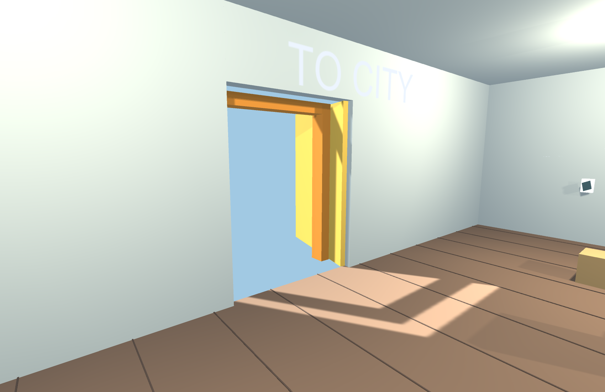

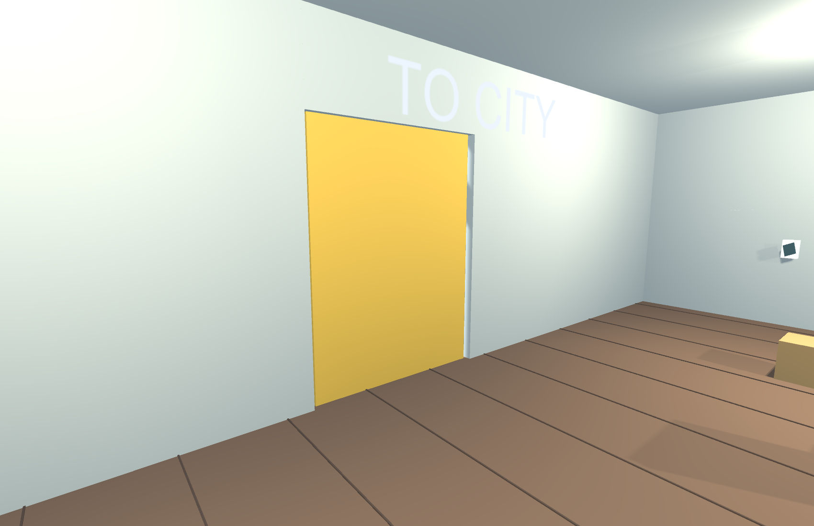

Входная дверь использует тот же HingedDoor и ту же клавишу O, что и шкафы. Различаются размеры и положение оси.

<!-- page -->
## Алгоритм вращения и ограничение доступа

HingedDoor хранит фактический угол angle и целевое состояние targetOpen. В FixedUpdate угол приближается к 0 или 105 градусам со скоростью 85 градусов в секунду. Rigidbody.MoveRotation передаёт поворот физическому телу. Mathf.MoveTowards ограничивает угол и исключает перескок через конечное положение.

Каждый предмет внутри шкафа получил CabinetItem, производный от PortableItem. Свойство CanTake возвращает true только при угле связанной двери не менее 65 градусов. Дополнительно сохраняется проверка расстояния и луч видимости в RoomInteractor.Take. Таким образом, логическое разрешение не позволяет брать предмет через другую стенку шкафа.

```csharp
public bool IsOpen => angle >= 65;
public override bool CanTake => door && door.IsOpen;

angle = Mathf.MoveTowards(angle,
    targetOpen ? openAngle : 0, speed * dt);
body.MoveRotation(Quaternion.Euler(0, angle, 0));
```

В автоматической проверке закрытая створка одновременно запрещает CanTake и становится первым коллайдером на луче к предмету. После поворота проверяется успешный Take. Затем дверь закрывается, и её угол должен вернуться к нулю. Это проверяет ограничения доступа и полный цикл механизма.

Во время разработки проверка обнаружила, что персонаж стоял внутри дуги створки и был оттеснён её коллайдером. Позиция наблюдателя вынесена за эту дугу. Коллайдер двери оставлен активным: взаимодействие с персонажем является частью модели.

<!-- page -->
## Конструкция вентилятора

Настольный вентилятор размещён на первом столе. Он имеет основание, стойку, центральную втулку и три лопасти. Геометрия лопастей не участвует в контактах: их вращение показывает работу устройства, а воздушный поток рассчитывается отдельным компонентом RoomFan.


При включении ротор вращается со скоростью 900 градусов в секунду. Угол нормализуется в диапазон 0–360 градусов. Направление потока совпадает с локальной осью X устройства; источник потока расположен перед втулкой.

Красный и синий предметы имеют массу 0,08 кг. Другие переносимые предметы сохраняют прежнюю массу. Поток действует только на PortableItem с массой не более 1 кг и не действует на кинематическое тело, которое держит персонаж.

<!-- page -->
## Модель воздушного потока

RoomFan проверяет положение центра массы относительно выходного отверстия. В область воздействия входит тело впереди вентилятора на расстоянии до 5 м и не далее 0,8 м от оси потока. Луч до тела проверяет препятствия. Сила равна 1,8 Н у источника и линейно убывает с расстоянием.

```csharp
float forward = Vector3.Dot(delta, Direction);
if (forward <= 0 || forward > range) continue;
body.AddForce(Direction * strength *
    (1 - forward / range), ForceMode.Force);
```

Сила прикладывается в FixedUpdate. Изменение скорости, скольжение по столу, столкновения и падение рассчитывает физика Unity. Программного переноса предметов за край стола нет. При выключении устройства новые силы не прикладываются; текущая скорость тела сохраняется и уменьшается из-за контактов и сопротивления.

Это учебная модель воздушного потока, а не расчёт аэродинамики. Она не учитывает форму поверхности, турбулентность и давление. Условия задачи демонстрируются через направленную силу и реальные Rigidbody.

<!-- page -->
## Проверка сдувания в Play Mode

Два кадра сняты одной камерой в настоящем игровом режиме. Между ними вентилятор работал пять секунд. Проверяется выход красного тела за край и снижение высоты обоих лёгких предметов ниже 0,5 м.

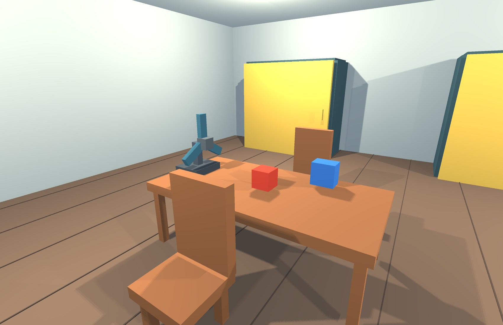

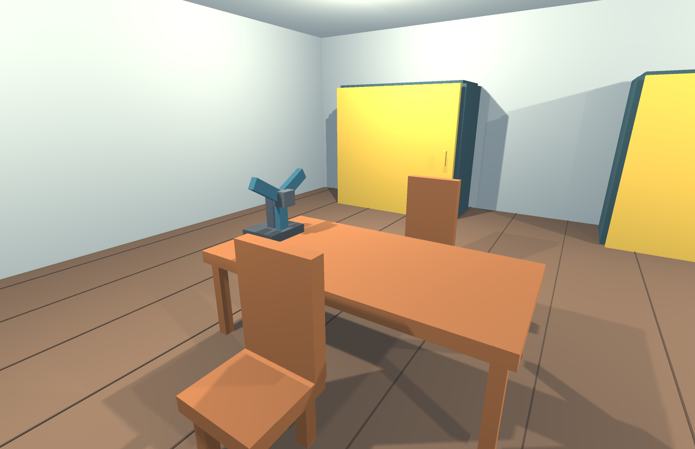

Исчезновение предметов со столешницы связано с их физическим падением. Объекты остаются в сцене и могут быть подобраны с пола.

<!-- page -->
## Окно и механизм жалюзи

Восточная стена перестроена вокруг оконного проёма. Стекло, обрамление и одиннадцать ламелей создаются отдельными объектами. Клавиша B меняет целевое состояние. За одну секунду параметр openness проходит между нулём и единицей.

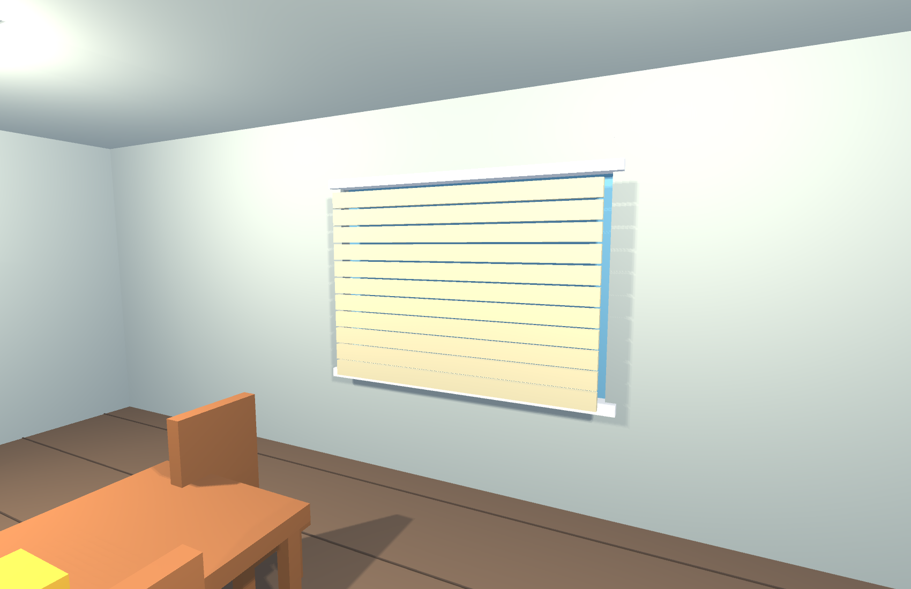

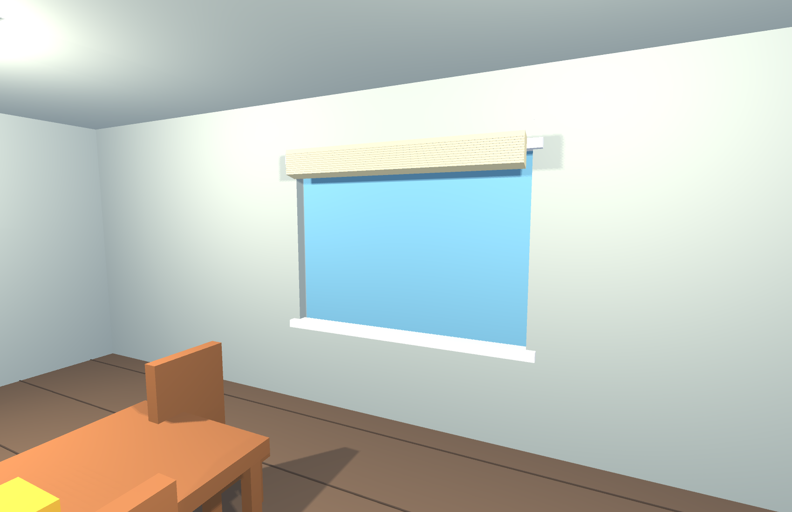

Каждая ламель одновременно поднимается и поворачивается на угол до 75 градусов. Их конечные высоты различаются, поэтому при подъёме образуется компактный пакет. Стекло остаётся физическим препятствием.

<!-- page -->
## Подтверждение взаимодействий во время выполнения

После открытия шкафа тест выбирает находящийся внутри предмет и переводит его в состояние удерживания. Проверяются разрешение доступа и видимость в реальной сохранённой сцене.

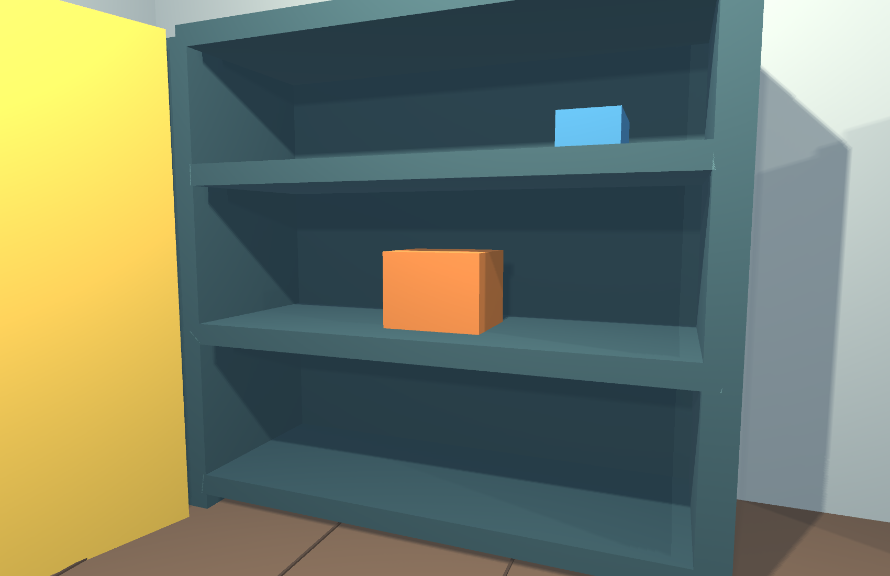

После этого тест закрывает шкаф, открывает входную дверь, включает вентилятор и выполняет цикл жалюзи. Игровые методы вызываются программно; физическое нажатие клавиатуры не имитируется. Обработчики O, F и B в RoomMechanisms вызывают эти же методы.

Состояния проверки не записываются поверх исходной сцены. При следующем запуске двери закрыты, жалюзи опущены, вентилятор выключен, а предметы расположены на исходных местах.

<!-- page -->
## Работа жалюзи в Play Mode

Открытое положение проверено не только установкой Transform при подготовке иллюстраций, но и изменением openness в FixedUpdate. Проверка ожидает значение больше 0,99, сохраняет кадр, затем закрывает жалюзи и ожидает значение меньше 0,01.

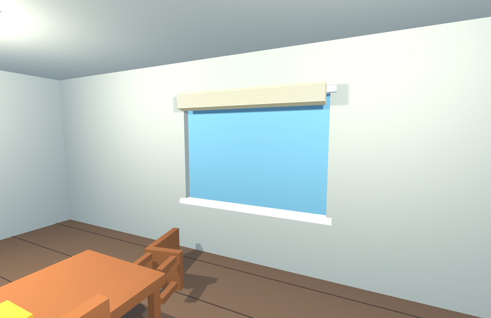

WindowBlinds не заменяет модель целиком: он изменяет локальные координаты и углы одиннадцати существующих ламелей. Поэтому повторное переключение возвращает те же объекты в исходное состояние. Изменение камер не сбрасывает параметры механизмов.

Двери, вентилятор и жалюзи работают независимо. Переключение света из предыдущей практической сохраняется. Порталы и динамическая мебель также остаются частью итогового проекта.

<!-- page -->
## Результаты проверки и состав проекта

verification.txt содержит четыре PASS: наличие трёх дверей, запрет доступа при закрытии, разрешение после открытия и подъём одиннадцати ламелей. runtime-verification.txt содержит двенадцать PASS: запрет взятия, физическое перекрытие луча, действие выбора двери, открытие, взятие, закрытие, входная дверь, сдувание, падение двух тел, вращение ротора, открытие и закрытие жалюзи.

| Компонент | Назначение |
|---|---|
| HingedDoor | Угловое движение коллайдера двери |
| CabinetItem | Проверка состояния связанной двери |
| RoomFan | Вращение ротора и сила воздушного потока |
| WindowBlinds | Подъём и поворот ламелей |
| RoomMechanisms | Клавиши O F B и выбор двери лучом |
| MechanismBuilder | Создание механизмов и кадров 01–08 |
| MechanismRuntimeVerification | Проверки Play Mode и кадры 09–12 |

Повторная генерация: Practicals → Build room mechanisms and evidence. Генератор открывает сохранённую сцену 8–9 и создаёт итоговую сцену 10–11. В Build Settings включена итоговая сцена. Автоматическая проверка запускается с -batchmode -executeMethod MechanismRuntimeVerification.Begin.

Использованы исходные ассеты города Kenney CC0 и собственная геометрия помещения и механизмов. Сведения об ассетах находятся в ASSETS.md. Ограничения: приводы дверей кинематические, а сопротивление человека не останавливает их мотор; воздушный поток упрощён; жалюзи показывают согласованное движение без моделирования гибкого шнура.
