# Практическая работа 12–16

## Строительная техника и перемещение сыпучих грузов

На сцене города из работы 6–7 построена отдельная площадка с бульдозером, экскаватором, самосвалом и башенным краном. Машины управляются клавиатурой. Физические гранулы можно переместить отвалом, собрать ковшом, высыпать в кузов, перевезти и выгрузить. Кран поднимает и отпускает отдельный груз через физическое соединение.

Выполнил: ____________________  Группа: ____________________

Среда: Unity 6000.4.6f1, Built-in Render Pipeline, C#, Input Manager. Исходное условие находится в assignment.docx. Проект открывается отдельно от предыдущих работ.

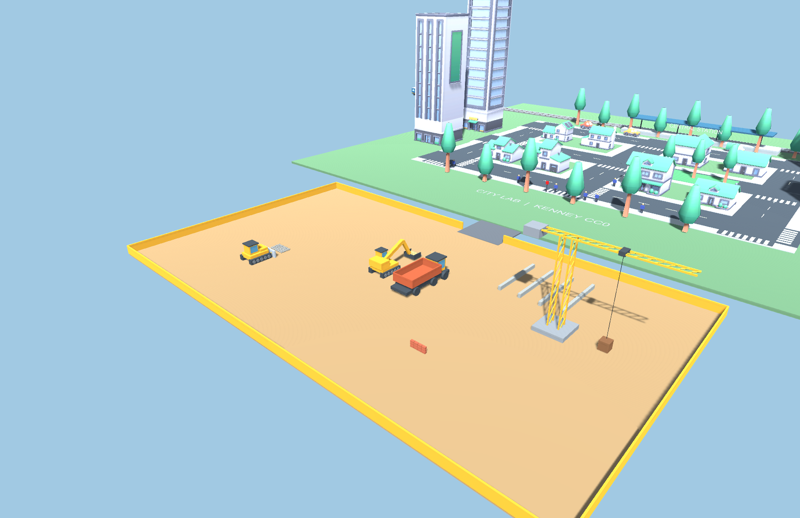

Отчёт содержит 17 кадров реальной сцены Unity. Кадры 09–17 получены во время Play Mode. В проверенном цикле экскаватор загрузил в самосвал 40 гранул, самосвал сохранил все 40 при перевозке и выгрузил их при наклоне кузова.

<!-- page -->
## Запуск и управление техникой

Открыть UnityProject в Unity Hub, затем Assets/Scenes/Practical12_16.unity. Нажать Play и щёлкнуть внутри Game. По умолчанию включён обзор площадки. Клавиши 1–4 выбирают машину; F6 показывает выбранную машину ближе. Управление персонажем отключено, чтобы стрелки не поворачивали одновременно человека и технику.

| Клавиша | Действие |
|---|---|
| 1 2 3 4 | Бульдозер, экскаватор, самосвал, кран |
| Стрелки вверх и вниз | Ехать вперёд и назад |
| Стрелки влево и вправо | Поворачивать шасси |
| Q и E | Вращать платформу экскаватора или стрелу крана |
| R и F | Поднимать и опускать стрелу, отвал или крюк |
| T и G | Изменять угол рукояти или вылет тележки крана |
| Y и H | Изменять угол ковша экскаватора |
| L | Удержать или отпустить гранулы ковшом; зацепить или отпустить груз краном |
| Z | Поднять или опустить кузов самосвала |
| F5 и F6 | Обзор площадки и выбранной машины |
| F1 F2 F3 F4 | Камеры исходного города |

Экранная панель показывает выбранную машину и положение её механизмов. Для экскаватора выводятся углы платформы, стрелы, рукояти и ковша, а также количество удерживаемых гранул. Для крана показываются вылет тележки, длина подвеса и состояние захвата.

<!-- page -->
## Размещение площадки в городе

Площадка размером 72 × 42 м размещена к югу от существующего города, около координаты Z = −78 м. Она соединена с городом коротким подъездом. Ограждение имеет коллайдеры и разрыв для въезда. Внутри выделены зона грунта, положение самосвала, зона крана и элементы будущего фундамента.

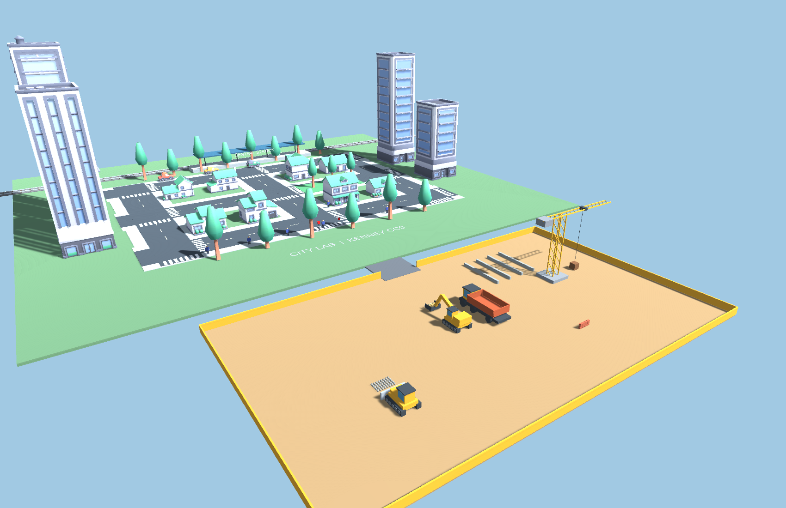

Сохранены автомобильный поток, пешеходы и поезд практической 6–7. Оборудование стройки создано собственной геометрией из примитивов. Городские модели Kenney и лицензии CC0 сохранены в Assets/ThirdParty/Kenney; источники перечислены в ASSETS.md.

ConstructionBuilder открывает исходную городскую сцену и добавляет новые объекты. Итоговая сцена сохраняется отдельно; в Build Settings включена только Practical12_16. Исходный город нужен для повторного построения площадки.

<!-- page -->
## Бульдозер и отвал

Бульдозер состоит из гусеничных блоков, корпуса, моторного отсека, кабины, рычагов и широкого отвала. Ширина отвала составляет 3,6 м, высота — 1,1 м. Начальная высота центра отвала равна 0,55 м, поэтому нижняя кромка находится у поверхности площадки.

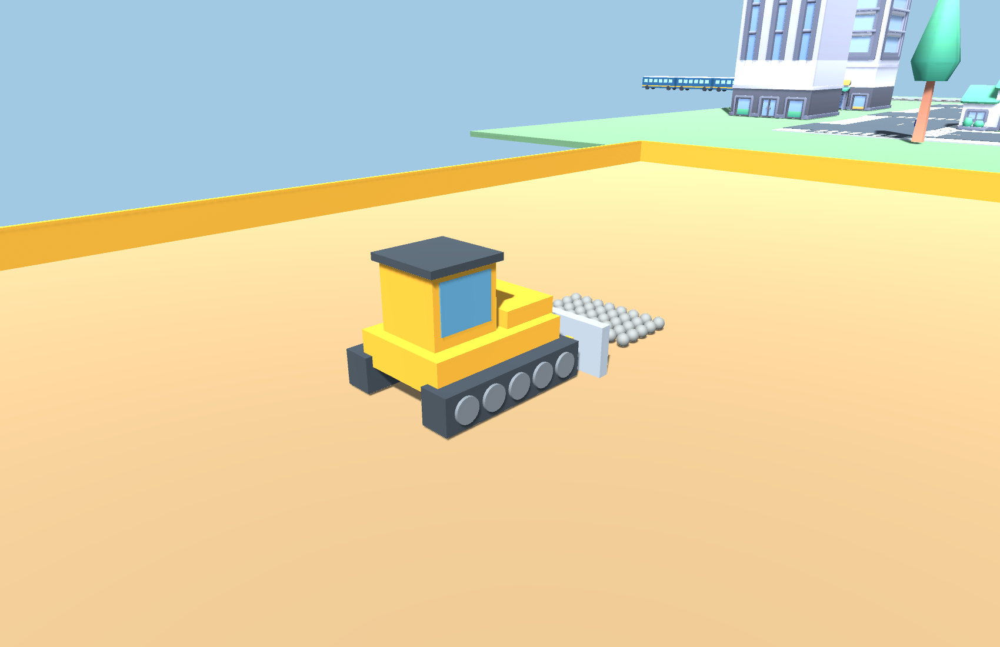

Кинематический Rigidbody шасси перемещается в FixedUpdate через MovePosition и MoveRotation. Коллайдер отвала входит в состав машины. При движении вперёд он контактирует с динамическими камнями и передаёт им движение. Координаты камней в игровом коде бульдозера не изменяются напрямую.

Клавиши R и F изменяют высоту отвала в диапазоне 0,55–1,8 м. В нижнем положении он собирает камни; в верхнем может проходить над небольшими объектами. Базовая скорость бульдозера — 2 м/с, скорость поворота шасси — 45 градусов в секунду.

<!-- page -->
## Кинематическая цепь экскаватора

Экскаватор имеет шасси, поворотную платформу, стрелу длиной 4 м, рукоять длиной 3 м и ковш. Иерархия Transform задаёт последовательность осей: поворот платформы по Y, затем углы стрелы, рукояти и ковша по X. Каждая последующая часть наследует преобразования предыдущей.

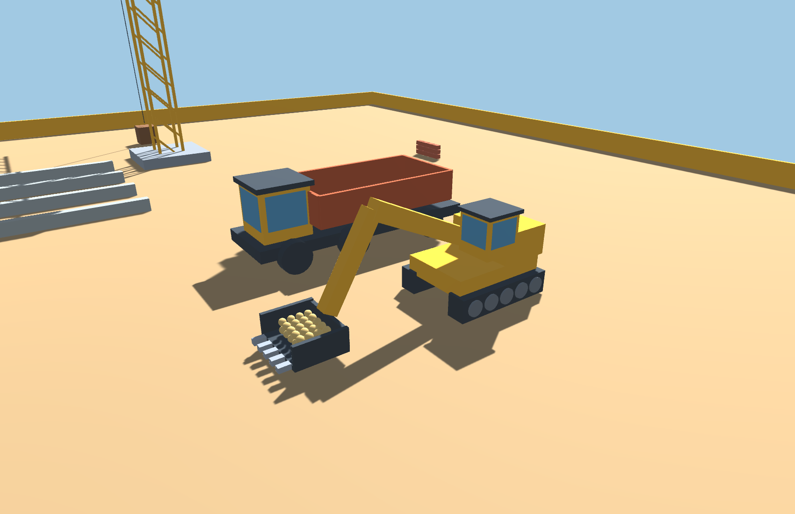

Исходные углы составляют −25 градусов для стрелы, 85 для рукояти и −60 для ковша. Их сумма равна нулю, поэтому дно ковша находится горизонтально. Начальная точка ковша выбрана в зоне небольшого объёма гранул.

Платформа вращается со скоростью 35 градусов в секунду. Угол стрелы ограничен диапазоном −65–0 градусов, рукояти — 10–100, ковша — −100–75 при ручном управлении. Подъём меняет геометрию всей цепи, а не перемещает груз к заранее заданной точке кузова.

<!-- page -->
## Самосвал и физический кузов

Самосвал состоит из рамы, кабины, колёс и наклоняемого кузова. Пол кузова имеет размер 3,3 × 6 м. Две боковые стенки, передняя стенка и задний борт образуют открытый контейнер из пяти коллайдеров.

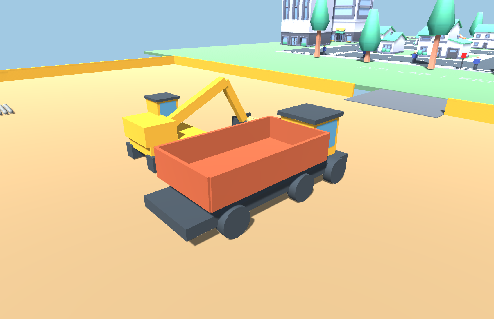

Шасси движется со скоростью до 2,5 м/с. Груз после загрузки не становится дочерним объектом самосвала: его удерживают поверхность пола, борта, трение и контакты. Это позволяет проверить сохранение груза именно при физической перевозке.

Нажатие Z поднимает кузов до 45 градусов со скоростью 18 градусов в секунду. Ось наклона расположена у заднего края. Когда угол превышает 8 градусов, задний борт откидывается на 110 градусов наружу. При повторном нажатии кузов возвращается в горизонтальное положение и борт закрывается.

<!-- page -->
## Башенный кран

Кран включает основание, решётчатую башню высотой 12 м, горизонтальную стрелу, противовес, тележку, подвес и крюк. Рёбра фермы построены отдельными элементами. Подвес отображается LineRenderer между тележкой и крюком.

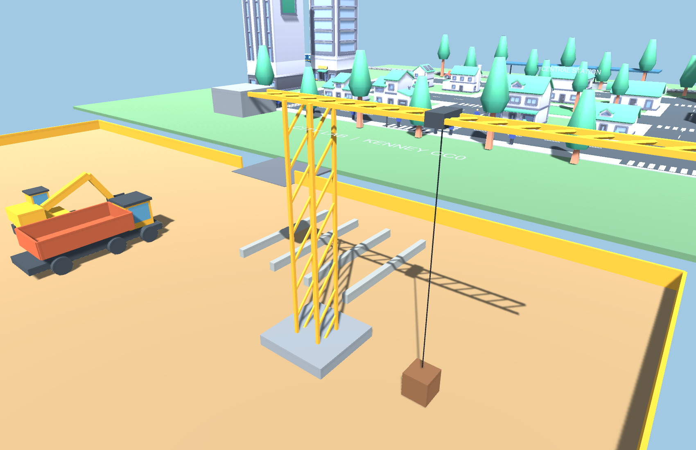

Q и E поворачивают стрелу, T и G изменяют вылет тележки в пределах 2–12 м, R и F меняют длину подвеса в пределах 1–11,2 м. Положение кинематического Rigidbody крюка обновляется через MovePosition.

L ищет LiftableLoad в радиусе 1,2 м от крюка. Для найденного подходящего объекта создаётся FixedJoint, соединяющий динамический груз с крюком. Масса ящика составляет 60 кг. Повторное L удаляет соединение; груз продолжает движение как свободное физическое тело и падает на площадку.

<!-- page -->
## Сыпучие объекты и материалы контакта

В сцене созданы 40 сферических гранул диаметром 0,22 м, 40 камней диаметром 0,3 м и 12 кирпичей размером 0,5 × 0,25 × 0,3 м. Это укрупнённые учебные тела, а не моделирование отдельных песчинок природного размера.

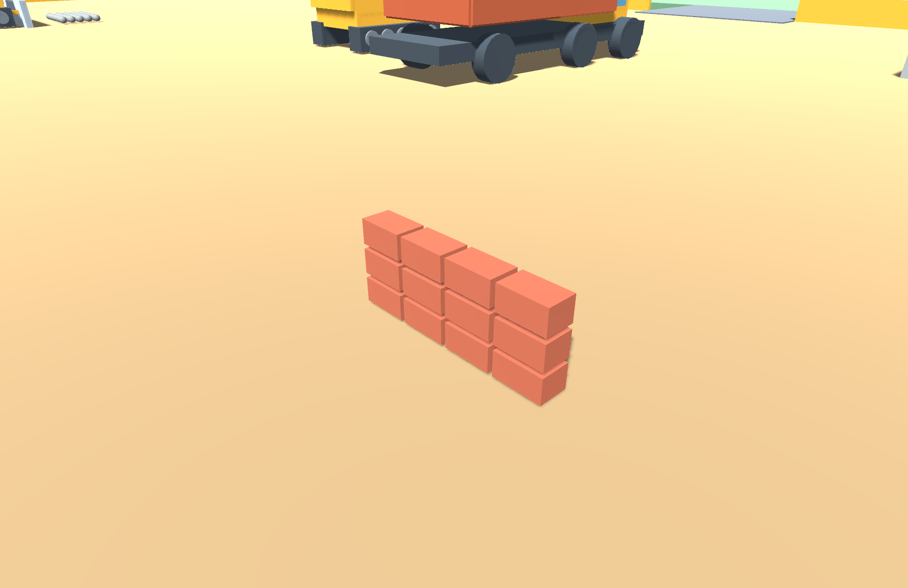

Все 92 объекта имеют Rigidbody и коллайдер. Масса тела задана 0,6 кг для демонстрации. Материал контакта имеет динамическое трение 0,45, статическое 0,5 и упругость 0,02. Используются ContinuousDynamic и интерполяция.

<!-- page -->
## Захват гранул ковшом

Ковш имеет дно, боковые стенки, заднюю стенку и открытый передний край с зубьями. Перед захватом гранулы свободно оседают под действием гравитации. В проверке сцена работает две секунды, после чего Collect запрашивает пересечения внутреннего объёма ковша через Physics.OverlapBox.

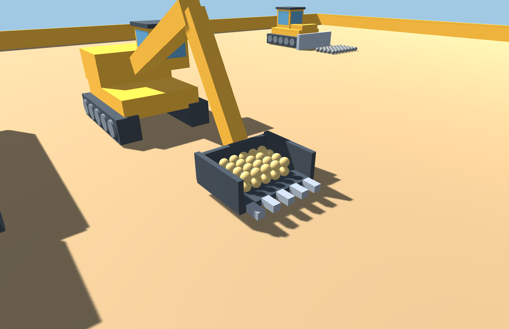

Захватываются только уже существующие ConstructionGrain, попавшие в объём. Их скорость обнуляется, Rigidbody временно становится кинематическим, а Transform получает родителя ковша с сохранением мирового положения. Новые гранулы при захвате не создаются. В проверенном запуске захвачено 40 тел.

Это упрощённый фиксатор содержимого ковша. Он гарантирует удержание при учебном управлении несколькими осями. После отпускания гранулы снова становятся динамическими; дальнейшая выгрузка и перевозка рассчитываются физикой. Полноценное моделирование копания в деформируемом грунте в проект не входит.

<!-- page -->
## Подъём ковша с грузом

После захвата стрела поднимается от −25 до −55 градусов, а рукоять изменяет угол с 85 до 50 градусов. Угол ковша устанавливается равным отрицательной сумме углов стрелы и рукояти: это сохраняет горизонтальное дно при подъёме.

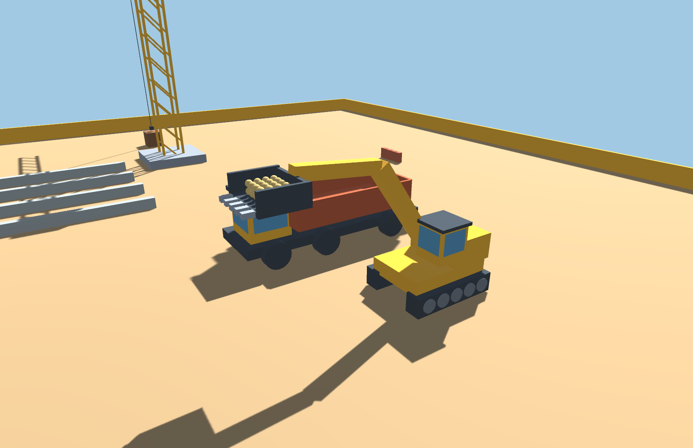

В тесте эти изменения выполняются плавно за две секунды, затем проверяется, что ось ковша находится выше четырёх метров. Гранулы следуют за ковшом в его собственной системе координат. Их положение не назначается координатам самосвала.

Для ручного повторения выбрать машину 2, нажать L и ориентироваться на показания панели: Boom около −55, Stick около 50, Bucket около 5. Угол платформы пока оставить около нуля. Эти значения соответствуют подготовленной схеме загрузки в стоящий рядом кузов.

<!-- page -->
## Поворот платформы и разгрузка ковша

Поднятая платформа разворачивается вправо на 90 градусов. Ковш проходит над кузовом, сохраняя удерживаемые тела. Затем фиксатор отпускается, а ковш наклоняется вперёд. Открытый край позволяет гранулам скатиться и упасть в кузов.

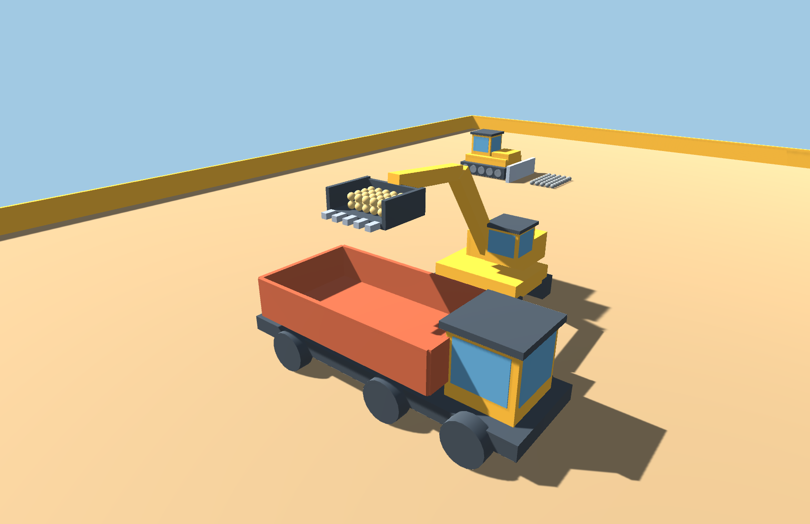

При ручном управлении удерживать E до Slew около 90. Для выгрузки нажать L, затем Y для наклона ковша. Угол ковша 75 градусов даёт наклон дна около 70 градусов при поднятой стреле и рукояти. Это положение используется и в автоматической проверке.

Release снимает родителя с каждого тела, возвращает isKinematic = false и пробуждает Rigidbody. Объекты оказываются над кузовом вследствие движения реальной кинематической цепи. Попадание в кузов не обеспечивается программной установкой координат груза.

<!-- page -->
## Оседание груза внутри кузова

После наклона ковша тест ожидает окончания падения. Количество тел в кузове определяется по их координатам в локальной системе наклоняемого кузова. Проверяемая область исключает внешнюю поверхность стенок и пространство под днищем.

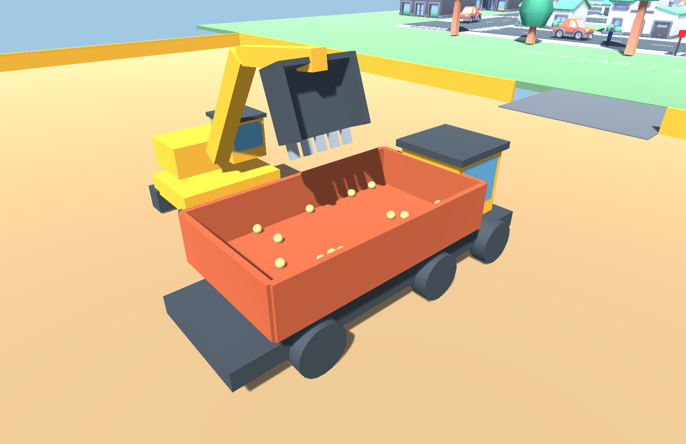

Порог успешности — не менее 15 тел. В итоговом запуске внутрь кузова попали все 40 захваченных гранул. Это значение записано в telemetry.csv на этапе 3 около времени 13 секунд.

Подсчёт не создаёт коллайдеры и не влияет на движение. Он служит измерением результата. На кадре часть гранул закрыта ближней стенкой кузова, поэтому их полный состав подтверждается числом в телеметрии, а не только видимой частью изображения.

<!-- page -->
## Перевозка сыпучего груза

Самосвал получает команду движения вперёд на две секунды с половинной интенсивностью. Номинальная скорость при этом составляет 1,25 м/с. Проверяется перемещение шасси более чем на один метр и сохранение в кузове не менее 60 процентов загруженных тел.

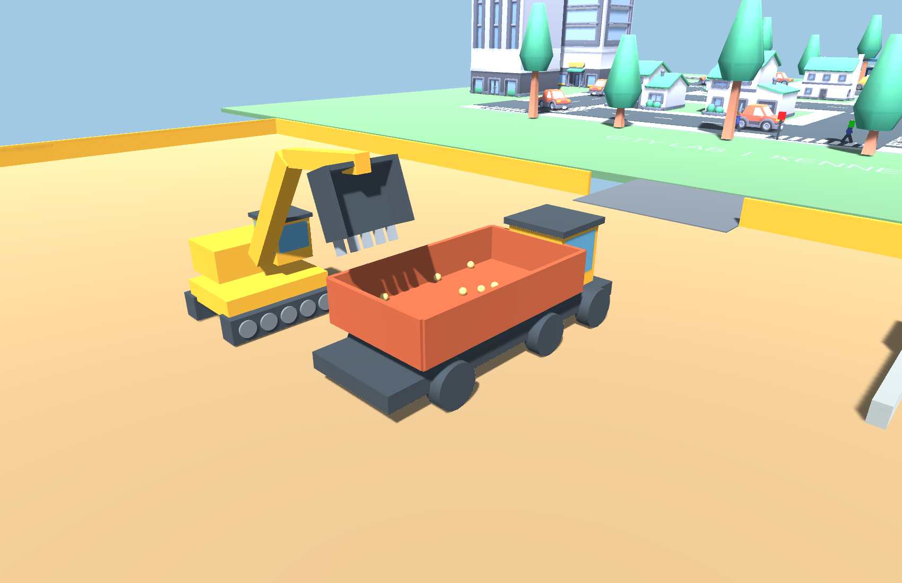

В итоговом запуске количество гранул осталось равным 40. Каждая гранула продолжает быть самостоятельным динамическим телом. Дно и борта движутся вместе с шасси и взаимодействуют с грузом через физические контакты.

При движении машины запрашиваются препятствия через SweepTestAll. Фиксированные поверхности и другие кинематические тела могут остановить поступательное движение. Динамический сыпучий материал остаётся доступным для толкания. Координаты шасси дополнительно ограничены пределами площадки.

<!-- page -->
## Перемещение камней бульдозером

Бульдозер начинает перед прямоугольной группой из 40 камней. В проверке он движется вперёд 3,5 секунды с интенсивностью 0,65. Нижний отвал контактирует с группой и раздвигает её.

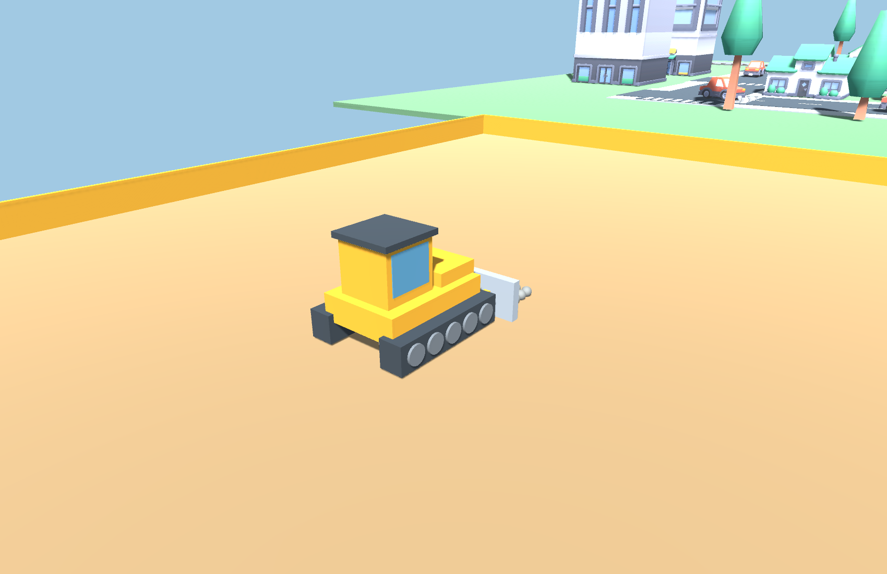

Измеряется средняя мировая координата Z всех камней до и после воздействия. Начальное значение составляет −82,580 м, после движения — около −79,397 м. Среднее смещение равно примерно 3,18 м; порог проверки — 0,6 м.

Сферические камни после толкания продолжают катиться, поэтому их положение меняется и на последующих этапах телеметрии. Это движение не обозначает продолжение команды бульдозеру: команда drive после проверки сбрасывается в ноль. Кирпичи представляют отдельный набор прямоугольных тел, который также можно двигать техникой.

<!-- page -->
## Подъём и освобождение груза краном

Крюк соединяется с динамическим ящиком через FixedJoint. Подвес укорачивается с 10,5 до 6 м; затем стрела поворачивается на 30 градусов. Высота центра ящика возрастает с 0,6 до 5,1 м.

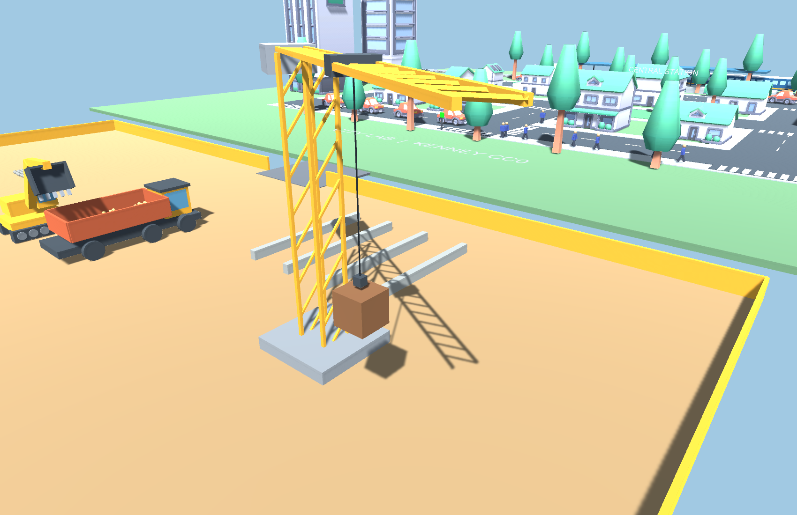

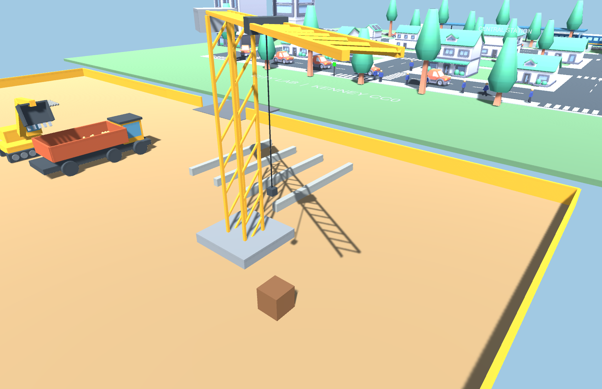

После снятия соединения проверяется свободный динамический режим и приземление ниже 1,5 м. Кадры сняты с одного положения камеры до и после освобождения.

<!-- page -->
## Выгрузка самосвала

На последнем этапе кузов поднимается до 45 градусов, а задний борт откидывается. Составные коллайдеры поворачиваются вместе с кузовом. Гранулы скользят к заднему краю, покидают кузов и падают на площадку.

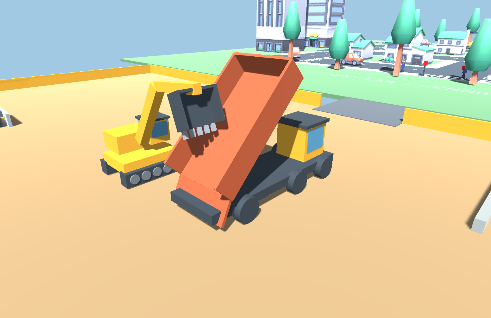

Тест ожидает восемь секунд и проверяет фактический угол более 44 градусов. Затем повторно подсчитывает груз: в кузове должно остаться менее половины первоначально загруженных тел. В итоговом запуске осталось ноль из 40.

Объекты при разгрузке не удаляются. На этапе захвата и выгрузки не создаются новые экземпляры: весь цикл использует исходные 92 физических объекта. Для повторного цикла пользователь может опустить кузов, вернуть технику в рабочее положение и собрать доступные гранулы ковшом.

<!-- page -->
## Результаты автоматической проверки

verification.txt содержит четыре PASS: четыре машины, 92 физических тела, пустой список фиксатора ковша в исходной сцене и пять коллайдеров кузова. runtime-verification.txt содержит 16 PASS, полученных в настоящем Play Mode.

| Измерение | Результат итогового запуска |
|---|---|
| Общее число сыпучих тел после оседания | 92 |
| Захвачено ковшом | 40 гранул |
| В кузове после загрузки | 40 гранул |
| В кузове после перевозки | 40 гранул |
| В кузове после выгрузки | 0 гранул |
| Среднее смещение камней при толкании | Около 3,18 м по Z |
| Высота центра груза крана до подъёма | 0,60 м |
| Высота центра груза после подъёма | 5,10 м |
| Конечный угол кузова | 45 градусов |

telemetry.csv содержит девять строк измерений по этапам, время сцены, количество удерживаемых тел и тел в кузове, среднюю координату камней и высоту груза крана. Прогон занимает около 35,3 секунды игрового времени. Ввод клавиатуры автоматически не имитируется: тест задаёт команды и углы тем же компонентам, которыми управляет пользователь.

Проверяются не только конечные положения машин, но и результат физического взаимодействия: фактическое попадание гранул в кузов, удержание во время перевозки, смещение камней и свободное падение освобождённого груза.

<!-- page -->
## Реализация и воспроизведение

| Файл | Назначение |
|---|---|
| ConstructionMachine.cs | Шасси и положение механизмов |
| ConstructionControls.cs | Выбор машины, клавиши, камера и панель состояния |
| ConstructionGrain.cs | Маркер физического сыпучего объекта |
| ExcavatorBucket.cs | Отбор тел в объёме, удержание и отпускание |
| CraneHoist.cs | Поворот стрелы, тележка, крюк и FixedJoint |
| LiftableLoad.cs | Разрешение зацепления груза краном |
| ConstructionBuilder.cs | Создание сцены и кадров 01–08 |
| ConstructionRuntimeVerification.cs | Полный цикл и кадры 09–17 |

Practicals → Build construction site and evidence повторно открывает город 6–7 и создаёт площадку, итоговую сцену и первые восемь изображений. Проверка запускается параметрами -batchmode -executeMethod ConstructionRuntimeVerification.Begin. Она обновляет журнал Play Mode, telemetry.csv и кадры 09–17. Пользовательские изменения сцены перед генерацией сохранить под другим именем.

Ограничения модели: приводы техники кинематические, гусеницы и колёса не моделируют тяговую динамику; гранулы укрупнены; фиксатор ковша временно удерживает тела; подвес крана отображается прямым отрезком и соединением, без расчёта гибкого троса. Параметры не калибровались по реальной машине. Проект демонстрирует управляемые механизмы, коллайдеры, перенос и пересыпание физических грузов по условиям практической работы.

